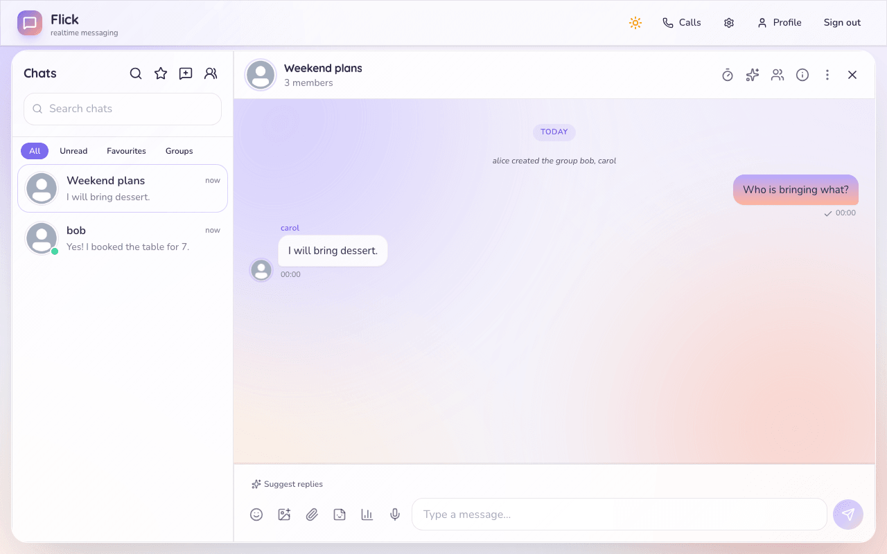
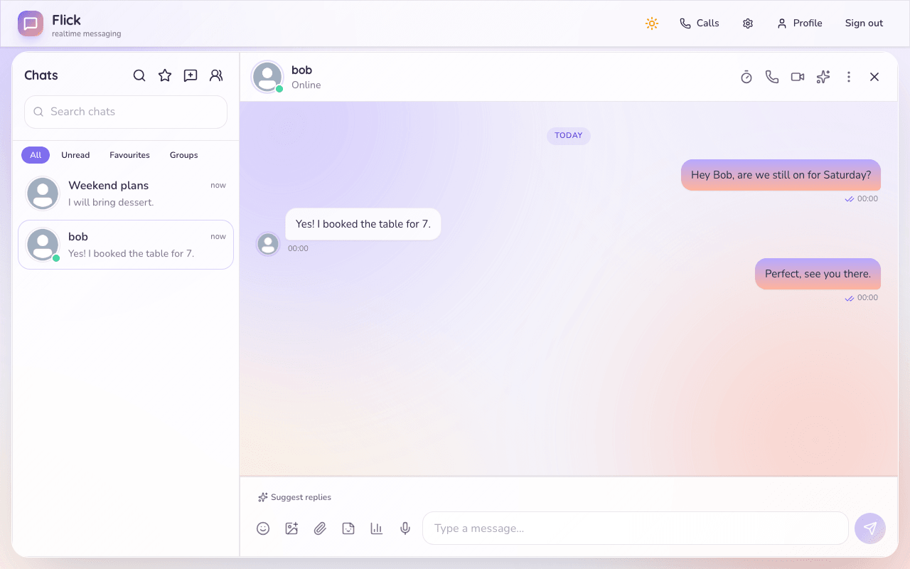
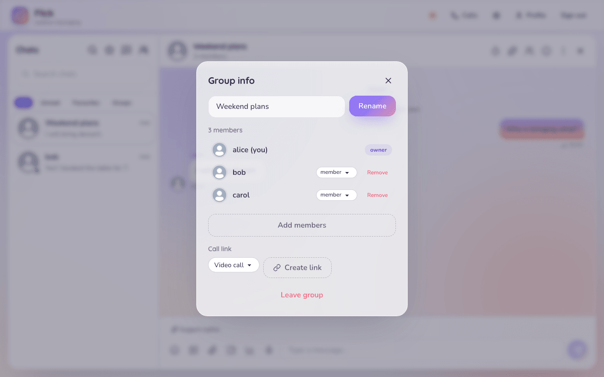

# Flick

Flick is a real-time chat app I built to learn how messaging systems stay correct: no lost messages, no duplicates,
the right order, and a way back after a disconnect. It has 1:1 and group chat, rich messages, files up to 1 GB, calls, an
installable web app and an AI layer (writing help, translation, transcription, file and image explanation, and the Flick
assistant) that runs only when you ask. The part I care about most is the delivery pipeline.

Related: [`docs/README.md`](docs/README.md), [`docs/architecture/overview.md`](docs/architecture/overview.md),
[`docs/features/README.md`](docs/features/README.md), [`docs/ai/README.md`](docs/ai/README.md),
[`docs/status.md`](docs/status.md), [`docs/operations/deployment.md`](docs/operations/deployment.md).

<p>
  
  
  
</p>

## What it does

| Area | Highlights |
| ---- | ---------- |
| **Chat** | Direct chats and groups (roles, invite links, join requests), edit with history, delete, reactions, replies, forward, mentions, pins, stars, private notes, drafts that follow you, scheduled messages, reminders, Saved messages, search (Postgres full-text, includes voice-note transcripts) |
| **Receipts and presence** | Sent, delivered and read are separate states. Online, typing, last seen (with privacy settings) |
| **Offline** | One sync call catches a client up. The installable app (PWA) keeps an offline outbox and gets Web Push |
| **Content** | Images, video, **albums** (up to 20 items) with a full-screen viewer, **any file type up to 1 GB** with PDF preview, voice notes with waveform, polls, GIFs and stickers, link previews, **Markdown everywhere**, checklists, expense splits, small games, shared Events with RSVP, disappearing and view-once messages |
| **Organising** | Archive, pin, mute, favourites, folders and coloured tags, wallpapers, chat lock, hidden chats, calendar of events |
| **Calls** | 1:1 WebRTC calls (TURN), group calls and call links through LiveKit, ringing for offline people |
| **Groups** | Roles, slow mode, welcome text, flagged-message list, activity analytics, incoming webhooks |
| **AI** | Used in many places and always on request: writing help and tone, translation and auto-translate, voice transcription, image / PDF / file explanation, conversation understanding, the **Flick** assistant (memories, topics, `@flick` in chats), group and productivity helpers. Per-chat privacy switch (enforced on every AI path, including background jobs) and a daily quota. Start at [`docs/ai/README.md`](docs/ai/README.md) and [`docs/ai/feature-map.md`](docs/ai/feature-map.md) |
| **Safety and privacy** | Local scam, link and impersonation checks, block and report, new-device sign-in alerts, devices list, data export and account delete |
| **Phone** | Back button and back swipe close overlays one by one, edge swipe back, double Back to exit in the installed app |
| **Look** | Calm solid-surface design, light and dark, six accents, serif default font, global and per-chat wallpapers, mobile tab bar ([`docs/design/design-system.md`](docs/design/design-system.md)) |

The full list with details is in [`docs/features/README.md`](docs/features/README.md).

## How a message is delivered

1. The client sends the message with a `client_message_id` it makes once and reuses on every retry.
2. The API opens one Postgres transaction: it checks membership, takes the next `seq` for the conversation, inserts the
   message and an **outbox** row, then commits and acks the sender. A retry returns the message that already exists.
3. A **dispatcher** inside the API claims unsent outbox rows and emits them to the current members over Socket.IO.
4. The recipient drops events it already has (by `seq`) and acks with a delivered cursor. Read is a separate cursor.
5. After a disconnect or an API restart the client calls **sync** with its last `seq` per conversation and gets what it
   missed from Postgres.

That is at-least-once delivery made safe with idempotency. The full contract is in
[`docs/architecture/delivery-guarantees.md`](docs/architecture/delivery-guarantees.md), and the reasons behind each
choice are short decision records in [`docs/decisions/`](docs/decisions/README.md).

## Stack

| Part      | Choice                                                                          |
| --------- | ------------------------------------------------------------------------------- |
| Web       | React 18, TypeScript, Vite, Zustand, Tailwind + daisyUI; installable (PWA)      |
| API       | Node.js 22, Fastify, Socket.IO (Redis adapter)                                  |
| Database  | PostgreSQL 17, the source of truth, with a transactional outbox (34 migrations) |
| Jobs      | pg-boss in a worker (push, reminders, scheduled messages, digest, expiry, cleanup) |
| Redis     | Socket.IO adapter, presence, rate limits, AI quota and cooldowns; never durable |
| Login     | Clerk, with sign-in screens inside Flick                                        |
| Files     | S3-compatible storage with presigned uploads and signed downloads (MinIO locally, AWS S3 when deployed) |
| Calls     | WebRTC with coturn for 1:1, LiveKit for groups                                  |
| AI        | Provider chain: Anthropic, Groq (2 accounts), Gemini (2 accounts), with cooldowns  |
| Tests     | Vitest (web about 2,170, API about 180 unit + about 1,800 integration on real Postgres/Redis/MinIO), Playwright |
| Monitoring | Prometheus and Grafana                                                         |

Monorepo layout: `apps/web`, `apps/api`, `apps/worker` and `packages/{contracts,database,ai,uploads,link-preview,shared}`.
Kafka/Redpanda is not used. It is deferred until there is a second consumer of message events or a measured need
([ADR-0004](docs/decisions/0004-inapi-dispatcher-redpanda-deferred.md)).

## Run it locally

You need Node 22.12 or newer, Docker, and a free [Clerk](https://clerk.com) application (development keys are enough).

```bash
npm install
cp .env.example .env
```

In `.env`, set `CLERK_SECRET_KEY` and `VITE_CLERK_PUBLISHABLE_KEY` from the Clerk dashboard. The other defaults work
locally.

Start Postgres, Redis and MinIO, then the migrations and the app:

```bash
docker compose -f infra/docker/compose.yml --env-file .env up -d postgres redis minio minio-init
set -a; source .env; set +a
export VITE_API_URL=http://localhost:4000
npm run migrate
npm run seed        # optional demo data
npm run dev         # api on :4000, worker, web on :5173
```

Open http://localhost:5173 and sign in with a Clerk user. In the Clerk dashboard set the sign-in and sign-up paths to
`/sign-in` and `/sign-up` (home and after sign-out `/`) and make username optional. GIFs, group calls, push, email-to-chat and the AI features turn on
when you set their keys (`GIPHY_API_KEY`, `LIVEKIT_*`, `VAPID_*`, `INBOUND_EMAIL_*`, `ANTHROPIC_API_KEY`, `GROQ_API_KEY_*`,
`GEMINI_API_KEY_*`); without them each one answers "unavailable" or "not configured" and the rest keeps working. What
each key unlocks is in [`docs/platform-setup.md`](docs/platform-setup.md).

### Scripts

| Command | What it does |
| ------- | ------------ |
| `npm run dev` | API (:4000), worker and web (:5173) together |
| `npm run build` | Build every workspace |
| `npm run typecheck` / `lint` / `format:check` | Static checks (`npm run format` fixes formatting) |
| `npm test` | Unit tests in every workspace |
| `npm run test:integration` | API and worker integration tests (need the test containers) |
| `npm run e2e` | Playwright browser tests |
| `npm run migrate` / `seed` / `db:reset` | Database migrations, demo data, reset |

### Environment (summary)

The full list, with what is required and what is optional, is in [`.env.example`](.env.example) and
[`docs/operations/deployment.md`](docs/operations/deployment.md).

| Variable | Needed | For |
| -------- | ------ | --- |
| `DATABASE_URL`, `REDIS_URL` | yes | Postgres and Redis |
| `CLERK_SECRET_KEY`, `VITE_CLERK_PUBLISHABLE_KEY` | yes | Login |
| `CORS_ORIGINS` | yes in production | CORS and Clerk `authorizedParties` |
| `S3_*` | for uploads | Files |
| `ANTHROPIC_API_KEY`, `GROQ_API_KEY_1/2`, `GEMINI_API_KEY_1/2`, `AI_DAILY_LIMIT` | optional | AI and its daily limit (default 200 per user) |
| `GIPHY_API_KEY`, `LIVEKIT_*`, `TURN_*`, `VAPID_*`, `INBOUND_EMAIL_SECRET`, `INBOUND_EMAIL_DOMAIN` | optional | GIFs, group calls, relay, push, email-to-chat |

## Tests

```bash
npm run typecheck && npm run lint && npm run format:check
npm test                                  # unit tests in every package

eval "$(scripts/dev/test-deps-up.sh)"     # throwaway Postgres 17, Redis 7, MinIO
npm run test:integration
scripts/dev/test-deps-down.sh

npm run e2e                               # Playwright in real browsers (see tests/e2e/README.md)
```

Counts and what each suite proves are in [`docs/testing.md`](docs/testing.md). One known failing test (the chat-list query
plan in `packages/database`) is listed there and in [`docs/status.md`](docs/status.md).

`apps/api/test/integration/gate.int.test.ts` checks the delivery contract end to end: duplicate sends make one message,
concurrent sends get ordered seqs, a restart between commit and delivery loses nothing, an offline client recovers
everything, removed members get nothing, and receipts only move forward. What has been run, and what has not, is in
[`docs/status.md`](docs/status.md).

## Deploy

The demo runs on free plans: the web app on Vercel (`flick-app`, builds `apps/web`), the API and worker jobs in one
Render web service (`flick-server`, repo `gpr-27/flick`, auto-deploys `main` and runs `npm run migrate:prod` before the server starts; `render.yaml` calls the same service `flick-api`),
Postgres on Supabase, Redis on Render, files in a private S3 bucket, login on Clerk. Steps, free-plan caveats, Vercel
headers, Clerk dashboard settings, every environment variable and a troubleshooting table are in
[`docs/operations/deployment.md`](docs/operations/deployment.md); day-to-day operation is in
[`docs/operations/runbook.md`](docs/operations/runbook.md).

## Limitations

- Single region, one Postgres primary, no read replicas.
- Messages are plaintext on the server (TLS plus authorisation). End-to-end encryption is deferred
  ([ADR-0011](docs/decisions/0011-e2e-encryption-deferred.md)). Uploaded files are not virus scanned.
- The dispatcher runs in the API process, so a slow dispatch loop uses API CPU.
- No replay log. Recovery after a long outage is sync, which reads current data.
- The demo uses Clerk **development** keys and free hosting plans (the API sleeps after 15 minutes idle).
- Not verified yet: two API replicas under load, a Redis outage during traffic, real Clerk in the tests (a fake client
  is used), real Web Push delivery, and the full AI chain against every real provider.
- Known gaps (hands-free voice lock, background blur in calls, AI analysis of video and more) are in
  [`docs/audit/missing-features.md`](docs/audit/missing-features.md).

## Documentation

Everything is indexed in [`docs/README.md`](docs/README.md): architecture, features, AI, operations, performance,
security, design, decision records, status, changelog and the interview guide.
