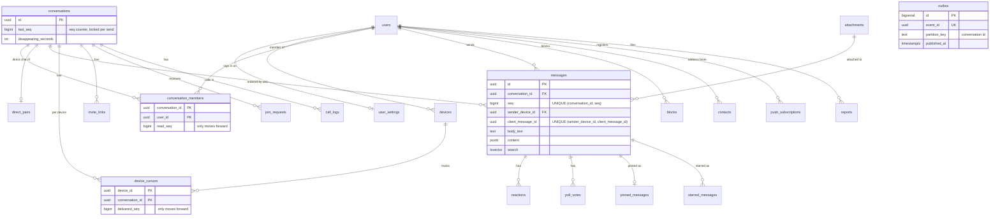

# Flick database schema

PostgreSQL 17 is the source of truth: users, conversations, the ordered message log, delivery
and read cursors, and the outbox of events to publish. Redis only holds short-lived state such
as presence and typing. The outbox rows are read by the dispatcher inside the API, which emits them to
Socket.IO.

Code lives in `packages/database/` (package `@chat/db`):

| Path                                           | What it is                                                              |
| ---------------------------------------------- | ----------------------------------------------------------------------- |
| `migrations/0001_identity.ts` … `0007_trim.ts` | Plain SQL migrations, each with an `up` and a `down`.                   |
| `src/types.ts`                                 | Kysely table types, kept in step with the migrations.                   |
| `src/db.ts`                                    | `createPool()` and `createDb(pool)`.                                    |
| `src/queries/`                                 | Shared SQL for sending, history, cursors, chat list, search and outbox. |
| `src/seed.ts`                                  | Demo and benchmark data.                                                |
| `test/`                                        | Tests against a real Postgres 17 container.                             |

## Commands

Run these from `packages/database/`. They all read `DATABASE_URL`.

| Command (from the repo root: `npm run <name> -w @chat/db`; `migrate`, `seed`, `db:reset` also work without `-w`) | Effect                                                                                  |
| ---------------------------------------------------------------------------------------------------------------- | --------------------------------------------------------------------------------------- |
| `migrate`                                                                                                        | Apply pending migrations.                                                               |
| `migrate:down`                                                                                                   | Revert the latest migration. Use `tsx src/migrate.ts down --all` to revert everything.  |
| `migrate:status`                                                                                                 | Show which migrations are applied.                                                      |
| `seed -- --scale small\|medium\|large`                                                                           | Empty every table and load seed data.                                                   |
| `db:reset -- --scale …`                                                                                          | Revert all migrations, re-apply them, then seed.                                        |
| `test`                                                                                                           | Start `postgres:17-alpine` on a random local port, run the tests, remove the container. |

**Environment variables:**

- `DATABASE_URL`: required by the commands.
- `NODE_ENV`: the seed refuses to run when it is `production`.
- `TEST_DATABASE_URL`: optional; makes the tests use an existing server instead of a container.

## ER diagram



## Tables

### Identity (`0001_identity`)

**`users`**

- `username` and `email` are `citext`, so uniqueness ignores case.
- `clerk_id` is the Clerk user id (migration 0006). It is unique; it is NULL for the bot and the
  seeded demo users. There are no passwords: Clerk handles login.
- `avatar_url` is the picture copied from the Clerk profile; `avatar_object_key` is for uploads.
- `is_bot` marks the **Flick** AI assistant. The migration creates it with the fixed id
  `FLICK_BOT_USER_ID` (in `src/bot.ts`). Its replies are ordinary messages.
- `is_demo` is reserved for demo accounts; nothing sets it today.
- `legacy_id` is reserved for importing users from an older system. Nothing writes it today.
- Users are never hard-deleted. Account deletion sets `status = 'deleted'`.

**`user_settings`**

- Who can see my last seen, photo and about (`everyone | nobody`; `about_privacy` came with migration 0009).
  The enum still has `contacts`, but nothing sets it: the product has no contact list.
- `groups_add_privacy` is stored but not used yet.
- Whether I send read receipts.

**`devices`**

- One row per browser or app. The client makes the id (`X-Device-Id`); the API creates the row on first sight.
- Delivery is tracked per device, so a user's phone and laptop each catch up on their own.
- `revoked_at` marks a logged-out device; the row is kept.

Migration 0006 dropped the `sessions` table (refresh tokens) and `users.password_hash`.

### Messaging (`0002_messaging`)

**`conversations`**

- `type` is `direct` or `group`. Groups must have a name.
- `last_seq` is the per-conversation sequence counter (see below).
- `disappearing_seconds`, `admin_only_send`, `admin_only_edit` and `approval_required` are the chat settings.
- `conversation_members.lock_hash` is the client's passcode hash for the chat lock (a UI convenience, not security).

**`direct_pairs`**

- One row per direct chat. The primary key `(user_lo, user_hi)` with `CHECK (user_lo < user_hi)`
  means two users can only ever have one direct chat. The database enforces this; it is not a
  racy "check, then insert" in the application.

**`conversation_members`**

- The primary key is `(conversation_id, user_id)`.
- Members have a `role`: `owner`, `admin` or `member`.
- `read_seq` is the highest seq the user has read. It only moves forward. Unread is
  `last_seq - read_seq`, so marking a chat read never touches message rows.
- The other columns are per-user chat options: `muted_until`, `archived`, `pinned_at`,
  `favourite`, `wallpaper`.
- Leaving sets `left_at`. The row stays, so old messages still have a sender.

**`attachments`**

- An uploaded file: `object_key` in object storage, `declared_mime` (from the client),
  `verified_mime` (detected from the bytes), `size_bytes`, `sha256`.
- `status` goes `pending → uploaded → attached`, or `deleted`.
- Sending a message with an attachment checks that the sender owns the upload, and sets `attached`.

**`messages`**

- `seq` gives the order inside a conversation.
- `client_message_id` is generated by the client and reused on retries.
- `type`: `text | image | file | voice | video | gif | sticker | poll | system |
call_event`.
- `body_text` is the text.
- `content` (jsonb) holds fields that only some types need: poll options, a voice waveform,
  call details.
- `attachment_id` points at the file, if any.
- `reply_to_id` is deliberately **not** a foreign key. The original message may be removed by
  disappearing messages, and the client then shows "message unavailable".
- Feature columns: `forwarded`, `view_once` and `viewed_at`, `expire_at` (disappearing messages),
  `mentions` (user ids, for highlighting; a mention does not bypass mute), `edited_at`.
- `deleted_at` makes the row a tombstone ("delete for everyone"). A CHECK clears the content; the
  row and its seq stay, so sync has no gaps.
- `search` is a `tsvector` generated from `body_text`. It uses the `simple` configuration (no
  stemming), because chats mix languages.

**`device_cursors`**

- One row per (device, conversation).
- `delivered_seq` is the highest seq the device acknowledged.
- `synced_seq` is the highest seq it has fetched through sync.
- Both only move forward.

**`reactions`**

- The primary key `(message_id, user_id, emoji)` means a user cannot add the same emoji to a
  message twice.

**`message_events`, `hidden_messages`, `view_once_opens`** (migration 0005)

- `message_events` is the log of edits, deletes and reactions. Its `seq` comes from the same
  counter as `messages.seq`, so sync can replay both in one order. Primary key
  `(conversation_id, seq)`.
- `hidden_messages` holds "delete for me" (one row per user and message). It takes no seq.
- `view_once_opens` records who opened a view-once message.
- Migration 0005 also changes `messages.client_message_id` from uuid to text, because the
  contract allows any 8-64 character id.

**`poll_votes`**

- The primary key `(message_id, user_id, option_index)` allows one vote per user per option.
- For single-choice polls the API deletes the user's old vote in the same transaction.
- The options themselves are in the poll message's `content`.

**`pinned_messages`**

- Messages pinned to the top of a chat, for everyone.

**`starred_messages`**

- Messages one user starred for themselves.

### Delivery (`0003_delivery`)

**`outbox`**

- Events written in the same transaction as the change they describe (see [Outbox](#outbox)).
- `topic` tells the dispatcher what to do with a row: `chat.message.v1`, `chat.receipt.v1` or
  `chat.conversation.v1`. These are only names; there is no broker.

**`processed_events`**

- `(consumer, event_id)` for every event a consumer has handled, so a redelivered event is skipped.
  Only needed for a future broker consumer; the dispatcher does not use it.

**`audit_log`**

- Meant for security-relevant actions. The table exists, but nothing writes to it yet.

### Social (`0004_social`)

**`blocks`** and **`contacts`**

- Each has a two-user primary key and a CHECK against self-references.

**`invite_links`**

- The table stores a SHA-256 of the link token, never the token itself.
- Optional expiry and maximum number of uses. A CHECK keeps `use_count <= max_uses`.
- `requires_approval`.

**`join_requests`**

- A partial unique index allows one pending request per user per group.

**`call_logs`**

- One row per call in a conversation: caller, audio or video, status, and when it started, was
  answered and ended.

**`call_links`** (migration 0008)

- Join links for LiveKit group calls. Like `invite_links`, only the SHA-256 of the token is stored.
- Always has an expiry; optional `max_uses`. Using a link never adds a conversation member.

**`push_subscriptions`**

- Web Push endpoints.
- `disabled_at` is set when the push service reports the subscription is gone.

**`reports`**

- Abuse reports. `evidence` keeps copies of the reported messages, so moderators can see them even
  after the messages are deleted.

**Foreign keys.** Rows that belong to something are deleted with it (`ON DELETE CASCADE`): members,
messages, cursors and reactions go with their conversation or message. Columns that only name an
actor (`created_by`, `sender_id`, `pinned_by`, …) become NULL instead (`ON DELETE SET NULL`).

## Indexes

Every index has a one-sentence reason next to it in the migration. "Write cost" is the extra work
each insert or update pays to keep the index up to date.

| Index                                                                                                     | Why it exists                                                                                                                  | Write cost                                                                                                                                                                                                                |
| --------------------------------------------------------------------------------------------------------- | ------------------------------------------------------------------------------------------------------------------------------ | ------------------------------------------------------------------------------------------------------------------------------------------------------------------------------------------------------------------------- |
| `messages_conversation_seq_uq (conversation_id, seq)` unique                                              | No two messages share a seq. It also serves history (`seq < cursor ORDER BY seq DESC`) and sync (`seq > cursor ORDER BY seq`). | One entry per message. Seqs grow within a conversation, so inserts land at the end of that conversation's range. 63 MB at 1M messages.                                                                                    |
| `messages_sender_device_client_id_uq (sender_device_id, client_message_id)` unique                        | The idempotency key: a retried send becomes `ON CONFLICT DO NOTHING`.                                                          | One entry per message, in random order. 62 MB at 1M messages.                                                                                                                                                             |
| `messages_search_idx` GIN on `(conversation_id, search)` (migration 0010)                                 | Full-text search.                                                                                                              | Every message with text adds entries. GIN batches its updates, but it is still the most expensive index here. 44 MB at 1.6M messages; migration 0010 made it about 0.05 ms slower per insert and search up to 30x faster. |
| `messages_expire_idx (expire_at)` partial                                                                 | The disappearing-messages job finds expired rows.                                                                              | Only messages with a timer.                                                                                                                                                                                               |
| `messages_attachment_idx (attachment_id)` partial                                                         | Deleting an attachment must find the messages that point at it.                                                                | Only messages with a file.                                                                                                                                                                                                |
| `conversation_members` primary key                                                                        | The "is this user a member?" check before every read and write.                                                                | Written once per membership.                                                                                                                                                                                              |
| `conversation_members_active_idx (conversation_id) INCLUDE (user_id, role)`, partial on `left_at IS NULL` | Fan-out reads the current members on every message, without touching the table.                                                | Changes only on join, leave or role change.                                                                                                                                                                               |
| `conversation_members_user_idx (user_id)`, partial on `left_at IS NULL`                                   | The chat list reads every chat a user is in.                                                                                   | Same.                                                                                                                                                                                                                     |
| `device_cursors` primary key                                                                              | Upsert target for every delivery ack.                                                                                          | One row per (device, chat).                                                                                                                                                                                               |
| `device_cursors_conversation_idx (conversation_id)`                                                       | Delivery ticks read every cursor of one conversation.                                                                          | Written once per row. It does not contain `delivered_seq`, so acks do not update it.                                                                                                                                      |
| `outbox_unpublished_idx (id)`, partial on `published_at IS NULL`                                          | The dispatcher asks for the oldest unpublished rows. The index only holds the backlog, however much history is kept.           | One insert per event; the entry disappears when the event is published.                                                                                                                                                   |
| `outbox_published_at_idx`, partial                                                                        | The retention job deletes events older than 7 days.                                                                            | One entry per published event.                                                                                                                                                                                            |
| `processed_events_processed_at_idx`                                                                       | The retention job deletes old dedupe rows.                                                                                     | One entry per processed event.                                                                                                                                                                                            |
| `users_clerk_id_uq`                                                                                       | Every request maps a Clerk id to a user.                                                                                       | Users are written rarely.                                                                                                                                                                                                 |
| `users_username_uq`, `users_email_uq`                                                                     | Two users cannot take the same name or email.                                                                                  | Users are written rarely.                                                                                                                                                                                                 |
| `users_legacy_id_uq`, partial                                                                             | Keeps `legacy_id` unique when set (unused).                                                                                    | Imported users only.                                                                                                                                                                                                      |
| `users_display_name_trgm_idx` (trigram GIN)                                                               | People search with `ILIKE '%term%'`.                                                                                           | Profile edits are rare.                                                                                                                                                                                                   |
| `devices_user_active_idx`, partial                                                                        | Delivery and presence list a user's active devices.                                                                            | One per device.                                                                                                                                                                                                           |
| `attachments_object_key_uq`                                                                               | One row per stored object.                                                                                                     | One per upload.                                                                                                                                                                                                           |
| `attachments_pending_idx`, partial                                                                        | The cleanup job finds abandoned uploads.                                                                                       | Only unfinished uploads.                                                                                                                                                                                                  |
| `pinned_messages_conversation_idx`                                                                        | Opening a chat loads its pins.                                                                                                 | Rare.                                                                                                                                                                                                                     |
| `message_events_message_idx`                                                                              | Finding the change log of one message.                                                                                         | One per edit, delete or reaction.                                                                                                                                                                                         |
| `outbox_event_id_uq`                                                                                      | An event id is unique.                                                                                                         | One per event.                                                                                                                                                                                                            |
| `starred_messages_message_idx`                                                                            | Deleting a message must find its stars.                                                                                        | Rare.                                                                                                                                                                                                                     |
| `invite_links_token_hash_uq`                                                                              | Opening a link finds it by hash.                                                                                               | Rare.                                                                                                                                                                                                                     |
| `join_requests_pending_uq`, partial unique                                                                | One pending request per user per group; also the admin's queue.                                                                | Rare.                                                                                                                                                                                                                     |
| `call_logs_conversation_idx (conversation_id, started_at DESC)`                                           | The calls tab, newest first.                                                                                                   | One per call.                                                                                                                                                                                                             |
| `push_subscriptions_endpoint_uq`, `push_subscriptions_user_idx`                                           | Re-subscribing updates the same row; sending loads a user's subscriptions.                                                     | Rare.                                                                                                                                                                                                                     |
| `reports_open_idx`, partial                                                                               | The moderation queue.                                                                                                          | Rare.                                                                                                                                                                                                                     |
| `audit_log_user_idx (user_id, created_at DESC)`                                                           | Security review of one user's actions.                                                                                         | One per audit entry.                                                                                                                                                                                                      |

**Indexes deliberately not created:**

- **`conversations.last_message_at`.** It changes on every message, and the chat list only sorts
  one user's chats, which is a small set.
- **`messages.sender_id` and `reactions.user_id`.** Users are never hard-deleted, so the cascade
  that would need these never runs in normal operation. Skipping them saves an index write on
  every message.

## Sending a message: sequence numbers and idempotency

`allocateSeqAndInsertMessage` in `src/queries/messages.ts` does this in one transaction:

```sql
BEGIN;
UPDATE conversations SET last_seq = last_seq + 1, last_message_at = now()
 WHERE id = $1 RETURNING last_seq;            -- locks this conversation's row
INSERT INTO messages (..., seq, ...) VALUES (..., <last_seq>, ...)
 ON CONFLICT (sender_device_id, client_message_id) DO NOTHING RETURNING *;
-- nothing returned => it's a retry: ROLLBACK (undoes the +1, so no gap) and return the original
-- otherwise: check membership / admin-only / attachment owner, INSERT INTO outbox
COMMIT;                                       -- the server acks the client only after this
```

**Why it is correct:**

- **Unique, gap-free seqs.** Two sends to the same chat queue on the row lock, and each reads the
  latest `last_seq`. Tested with 50 raw parallel transactions and 40 parallel sends.
- **A retry after a lost ack.** It finds the existing row through the unique index and returns it
  with `duplicate: true`. Its own `+1` is rolled back, so no seq is wasted.
- **Concurrent duplicates.** The first one commits. The others wait on the lock, conflict on the
  unique index, roll back, and return the first one's message. Tested with 25 concurrent copies:
  one row, one outbox event, and the next message gets seq 2.
- **Any failure after the insert** (not a member, admin-only group, someone else's attachment)
  rolls back the message, the seq and the outbox event together.

**Trade-off.** Sends to _one_ conversation are serialised by its row lock, so one very busy chat is
limited to roughly 1 ÷ (transaction time) messages per second. Different chats never wait for
each other, and there is no global lock. Measured on a laptop: about 450 to 650 messages per second for one conversation
(see [performance/database.md](../performance/database.md)).

**Membership changes.** Adding or removing a member writes a `system` message through the same
function (with `authorize: false`). The change therefore takes the same row lock and gets a seq,
and a send can never be checked against a membership that is changing at that moment.

## Receipts

- `advanceCursor` records delivery acks per device:
  `delivered_seq = GREATEST(old, new)`, capped at `last_seq`. A late or repeated ack can never move
  it back, and a client cannot acknowledge messages that do not exist yet.
- `advanceReadSeq` does the same for `conversation_members.read_seq`.
- **Delivered:** a message with seq S is delivered when every other member has at least one active
  device with `delivered_seq >= S`.
- **Read:** it is read when every other member has `read_seq >= S`. Reading implies delivery.
- `recipientCursors` returns each member's best cursor (used for group "message info").
  `receiptWatermarks` reduces them to the two numbers the ticks need.

## Outbox

1. **Write.** The send transaction inserts an outbox row with topic `chat.message.v1` and
   `partition_key` = the conversation id. Because the event commits or rolls back with the
   message, it can never be lost or dispatched for a message that does not exist.
2. **Claim.** The dispatcher in the API (`apps/api/src/modules/dispatcher`) runs
   `buildOutboxClaimQuery`: `SELECT … WHERE published_at IS NULL ORDER BY id LIMIT n FOR UPDATE
SKIP LOCKED`. Several API replicas can run it at once and each gets different rows.
3. **Emit.** It emits to Socket.IO rooms, sets `published_at` on the rows whose emit worked,
   and commits. The offline-notification job is queued in the same transaction.
4. **Failure.** A failed row gets `attempts + 1` and `last_error` and is retried with backoff;
   later rows of the same conversation wait. After 20 attempts the row is logged and skipped.
5. **Duplicates are harmless.** If the process dies after emitting but before committing, the
   row is emitted again. Clients ignore a `seq` they already have, and the notify job has a fixed
   id per (event, user), so it is queued once.
6. **Ordering.** Within one conversation, outbox ids follow seq order (tested), because both are
   assigned while the row lock is held. Clients still treat `seq` as the authority: they sort by
   seq, ignore duplicates, and request a sync if they see a gap.

`publishOutboxBatch` and `markEventProcessed` in `src/queries/outbox.ts` are the broker-shaped
helpers for the day a broker is added ([ADR-0004](../decisions/0004-inapi-dispatcher-redpanda-deferred.md));
nothing in the apps calls them now.

## Query patterns

| Query                        | Shape                                                                                       | Index used                                            |
| ---------------------------- | ------------------------------------------------------------------------------------------- | ----------------------------------------------------- |
| Latest messages              | `WHERE conversation_id = $1 ORDER BY seq DESC LIMIT n+1`                                    | `messages_conversation_seq_uq`                        |
| Scroll back                  | `… AND seq < $cursor ORDER BY seq DESC LIMIT n+1`                                           | same                                                  |
| Sync after reconnect         | `… AND seq > $cursor ORDER BY seq LIMIT n+1`                                                | same                                                  |
| Chat list with unread counts | members (user, active) join conversations; unread = `last_seq - read_seq`                   | `conversation_members_user_idx`, `conversations_pkey` |
| Fan-out recipients           | `conversation_members WHERE conversation_id = $1 AND left_at IS NULL`                       | `conversation_members_active_idx`                     |
| Search                       | messages join the user's active memberships, `search @@ websearch_to_tsquery('simple', $q)` | `messages_search_idx`                                 |
| Outbox claim                 | see above                                                                                   | `outbox_unpublished_idx`                              |

**Pagination rules:**

- Pagination is keyset on `seq`, never `OFFSET`, so a deep page costs the same as the first one.
- Messages that arrive during a sync cannot shift or duplicate rows. This is tested by sending
  messages in the middle of a sync.
- Each page fetches one extra row to learn whether there is a next page, so no `COUNT` is needed.
- Deleted messages come back as tombstones, so every device learns about the delete.

**Index-use tests.** `test/pagination.test.ts` runs `EXPLAIN` on each of these queries over
realistic data and checks that the intended index is used:

- 60k messages and 50k conversations;
- 50k published outbox rows.

## Retention and deletion

| Data                  | Rule                                                                    |
| --------------------- | ----------------------------------------------------------------------- |
| Published outbox rows | Deleted after 7 days (`purgeOldOutboxRows`).                            |
| `processed_events`    | Deleted after 14 days.                                                  |
| Disappearing messages | Deleted by a job once `expire_at` has passed.                           |
| Abandoned uploads     | Pending attachments older than 24 hours: file and row removed by a job. |

**What "delete" means:**

- **Delete for everyone** leaves a tombstone: content cleared, row and seq kept.
- **Disappearing messages** are physically deleted.
- **What remains:** deleted bytes can remain in Postgres until VACUUM, and in backups and replicas
  until those expire. We do not claim instant, complete erasure.

## Seed data

| Scale  | Users | Direct chats | Groups                   | Messages  | Load time (one run) |
| ------ | ----- | ------------ | ------------------------ | --------- | ------------------- |
| small  | 50    | 60           | 10 + "Demo Squad"        | 5,000     | 0.3 s               |
| medium | 300   | 600          | 60 + a 250-member group  | 100,000   | 3.5 s               |
| large  | 1,000 | 3,000        | 200 + a 600-member group | 1,000,000 | 34 s                |

The load times are a single run each on the development laptop (Postgres 17 in Colima). They are
not benchmarks.

**How the data is built:**

- Messages are bulk-loaded with `COPY`. The rest uses inserts of 1,000 rows at a time.
- Message counts per chat are skewed: a few busy groups and many quiet chats.
- Seqs are contiguous and `last_seq` matches (tested).
- About a third of members are a few messages behind, so unread counts vary.
- Re-running the seed gives the same counts (tested), because faker is seeded and used for every
  random choice.

**Demo users.**

- `alice`, `bob`, `carol`, `dave` and `erin` (`<name>@example.com`), plus every generated user, are
  plain local users with no `clerk_id`, so nobody can log in as them. To log in as a demo person,
  create a Clerk user (see `docs/security/auth.md`).
- Never seed a real deployment. The seed refuses `NODE_ENV=production`.
- The Flick bot user is always present: the migration creates it, and the seed re-creates it after
  emptying the tables.

## Observed plans (large seed, one run each)

These come from `EXPLAIN ANALYZE` on the development laptop. They show plan shape and are not
benchmark numbers.

| Query                                  | Plan                                                                                   | Time    |
| -------------------------------------- | -------------------------------------------------------------------------------------- | ------- |
| Latest 51 messages of the busiest chat | Index Scan Backward on `messages_conversation_seq_uq`                                  | 0.17 ms |
| Scroll back from seq 50,000            | Index Scan Backward on `messages_conversation_seq_uq`                                  | 0.03 ms |
| Sync 201 rows after seq 1,000          | Bitmap scan on `messages_conversation_seq_uq` + top-N sort (only 2.6k matching rows)   | 1.3 ms  |
| Search for one user                    | Bitmap scan on `messages_search_idx`, hash-joined with `conversation_members_user_idx` | 9 ms    |

At 1M messages the `messages` table is 511 MB in total, with a 315 MB heap.

## Limits and next steps

- **Hot chats.** A single very busy chat is limited by its row lock (see the trade-off above).
- **Partitioning.** `messages` is not partitioned. The natural first step is hash partitioning by
  `conversation_id`, which every hot query already filters on. The unique keys would then have to
  include `conversation_id`.
- **Search.** Postgres full-text search is enough at this size. A dedicated search engine is the
  next step if it stops being enough.
