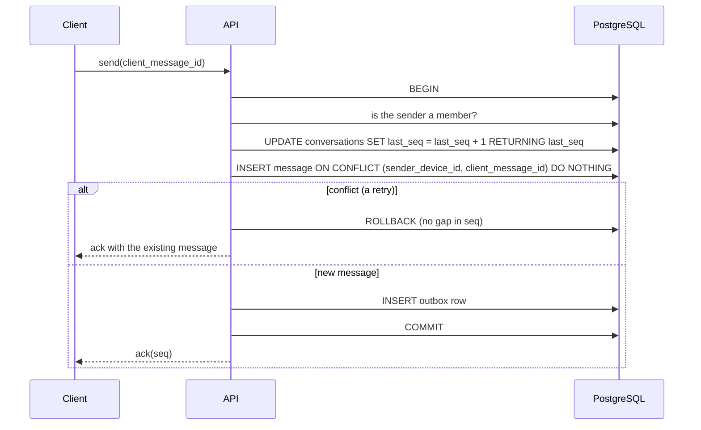

# Delivery guarantees

This is the delivery contract ([ADR-0008](../decisions/0008-at-least-once-with-idempotency.md)). What has been tested
is listed in [`../status.md`](../status.md). Event names are in [`protocol.md`](protocol.md) and table names in
[`database-schema.md`](database-schema.md). Code: `apps/api/src/modules/messages/`.

**In one sentence.** A message is acked to its sender only after it is committed in PostgreSQL with its sequence
number and its outbox row. From then on it is delivered **at least once** to current members, and clients show it
**once**, in `seq` order.

We do not claim exactly-once. A sender cannot tell "not delivered" from "delivered, ack lost", so it retries, and
every retry is made harmless.

## 1. The rules

1. **Stable `client_message_id`.** The client makes it once and reuses it on every retry.
2. **Membership is checked on every read and write.**
3. **One transaction** does: idempotency check, sequence allocation, message insert, outbox insert.
4. **Ack only after commit.**
5. **Dispatch with retry.** Clients drop duplicates by `seq`.
6. **Delivered is separate from read.**
7. **Sync after reconnect.**
8. **Membership changes take effect immediately.**

## 2. The send transaction

- The counter update locks one conversation row. Sends to the same conversation take turns. Others do not wait.
- A concurrent duplicate waits on that lock, then hits the conflict. Result: one message.
- No network calls happen inside the transaction.

## 3. Ordering

`(conversation_id, seq)` is unique and dense. Clients apply messages in `seq` order. If a live event arrives with a
`seq` that jumps ahead, the client runs sync to fill the gap. Order across different conversations is not defined and
is not needed.

## 4. What takes a seq

Anything that changes what a device should show takes the next number of the conversation: a new message, an edit, a
delete for everyone, a reaction added or removed. New messages live in `messages`; edits, deletes and reactions are
logged in `message_events`. Each change also writes an outbox row in the same transaction. Delete for me, star, pin and
poll votes take no seq: they affect one user or are not part of the ordered log.

The ack is sent only after COMMIT, so "accepted" always means "saved". `sendMessage` is a plain function: the Socket.IO
`send_message` handler and `POST /conversations/:id/messages` both call it.

## 5. Dispatch

The dispatcher inside the API ([ADR-0004](../decisions/0004-inapi-dispatcher-redpanda-deferred.md)):

1. claims unsent outbox rows with `FOR UPDATE SKIP LOCKED`;
2. reads the **current** members of the conversation;
3. emits to the Socket.IO room;
4. marks the row done after a successful attempt, or records the failure and retries with backoff.

A crash after step 3 and before step 4 means the event is sent again. That is the "at least once". Clients drop it
because they already hold that `seq`. A crash before step 3 means the row is still unsent and goes out after the
restart.

## 6. Receipts

| State     | Meaning                                   | Stored in                                   |
| --------- | ----------------------------------------- | ------------------------------------------- |
| Sent      | Committed, `seq` assigned                 | `messages`                                  |
| Delivered | A device of the recipient has received it | `device_cursors.delivered_seq` (monotonic)  |
| Read      | The recipient has seen it                 | `conversation_members.read_seq` (monotonic) |

Cursors only move forward (`GREATEST(old, new)`, capped at `last_seq`), so repeated or out-of-order acks are harmless. A
`receipt_update` outbox row is written only when a cursor really moved. A recipient has a message when their best
device cursor (or read cursor) is at or past its seq. In a group, "delivered" and "read" are
shown to the sender when every other member's cursor has passed the message.

## 7. Offline users and sync

An offline user has no socket. Nothing is queued per device. The messages are in Postgres. On reconnect the client
sends its last `seq` per conversation and the server returns everything after it, for conversations the user is a
member of **now**. Live events that arrive during sync are buffered, then applied after the sync page, dropping
duplicates by `seq`.

Sync pages are cut by seq (`seq > N ORDER BY seq LIMIT n`), never by offset, and messages and events are read in one
SQL statement, so a page is one snapshot. A seq only becomes visible after every lower seq has committed, so nothing
can appear later behind the cursor. Things that would otherwise leave a hole come back as tombstones: a message you
deleted for yourself or that has expired has no content, and an edit of a message that was deleted later comes back as
a delete.

Offline users also get a Web Push notification from a pg-boss job. The notification is a hint. The message itself
comes from sync.

## 8. Membership changes

Membership is read when a message is sent, when it is dispatched, and when history or sync is read. A removed member:

- cannot send, read history or run sync for that conversation;
- receives no event dispatched after the removal (recipients are read from Postgres for every
  outbox row; sockets are in per-user rooms, not per-conversation rooms).

Messages sent before the removal stay in the member's earlier copy, if the client kept it. The server does not recall
them.

## 9. Failure scenarios

| Scenario                                         | Result                                                                      |
| ------------------------------------------------ | --------------------------------------------------------------------------- |
| Client sends twice (ack lost)                    | Second send returns the same message. One row                               |
| Two clients send at the same moment              | Unique, ordered `seq` values                                                |
| API crashes before commit                        | No ack. The client retries. No message exists, or the retry creates it once |
| API crashes after commit, before dispatch        | Outbox row is unsent; dispatched after the restart. Sync also covers it     |
| Dispatcher emits but crashes before marking done | Event sent again. Clients drop by `seq`                                     |
| Socket drops                                     | Socket.IO reconnects; the client runs sync                                  |
| Redis down                                       | Other servers' rooms are not reached; sync recovers. Messages are stored    |
| Recipient offline for days                       | Sync returns all missed messages, in pages                                  |
| Member removed, then a message is sent           | Not dispatched to them; their sync is refused                               |
| Postgres down                                    | Send fails, no ack, the client keeps it in its outbox and retries           |

## 10. History, visibility and edit rules

`GET /conversations/:id/messages` pages backwards by seq. Rules applied in SQL:

- Deleted for everyone: returned as a tombstone with no content.
- Deleted for me: left out for that user only.
- Disappearing messages: `expire_at` is set at send time. Once it has passed the message is never returned, even
  before the worker removes the row.
- View once: after a recipient opens it (`POST .../open`) their copy has no content. The sender always sees it.

| Action              | Who                                | Limit                                                           |
| ------------------- | ---------------------------------- | --------------------------------------------------------------- |
| Edit                | the sender                         | 15 minutes, text or caption only                                |
| Delete for me       | any member                         | none, no seq                                                    |
| Delete for everyone | the sender, or a group owner/admin | none, takes a seq                                               |
| React               | any member                         | one reaction per user per message, a new emoji replaces the old |

`GET /search?q=` uses Postgres full-text search and joins on the caller's active memberships, so conversations they
are not in (or have left) can never match. The snippet is HTML-escaped; `<mark>` is the only markup.

## 11. Known limitations

- Messages are plaintext on the server (TLS plus authorisation). End-to-end encryption is deferred
  ([ADR-0011](../decisions/0011-e2e-encryption-deferred.md)).
- One Postgres primary. The throughput of one very busy conversation is limited by its row lock; measurements are in
  [`../performance/database.md`](../performance/database.md).
- The dispatcher shares the API process. A very slow dispatch loop could use API CPU.
- There is no replay log. After a long outage, recovery is by sync, which reads current data. Messages deleted in the
  meantime stay deleted.
- Delivery and read receipts in large groups are coarse.

## 12. Future roadmap

- A broker (Redpanda/Kafka) when there are independent consumers, a replay need or measured throughput limits
  ([ADR-0004](../decisions/0004-inapi-dispatcher-redpanda-deferred.md)).
- End-to-end encryption as its own security milestone.
