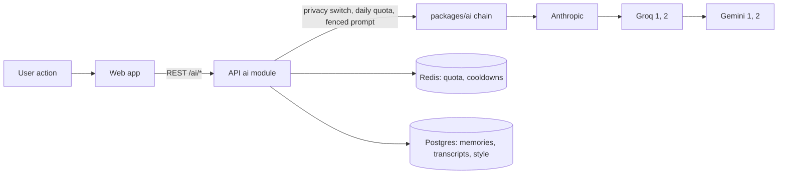

# Architecture overview

Flick is a real-time chat app with an AI layer. One npm workspaces monorepo (TypeScript, ESM, Node 22) holds a React
web app, a Fastify + Socket.IO API, a pg-boss worker and six shared packages. Messages are stored in PostgreSQL in one
transaction together with an outbox row; a dispatcher inside the API turns outbox rows into live events, and clients
repair any gap by syncing from Postgres. Around that core sit calls, notifications, productivity tools, group tools and
AI features that run only when the user asks, through a provider fallback chain.

Related: [`system-design.md`](system-design.md), [`delivery-guarantees.md`](delivery-guarantees.md),
[`protocol.md`](protocol.md), [`database-schema.md`](database-schema.md), [`../ai/README.md`](../ai/README.md),
[`../ai/architecture.md`](../ai/architecture.md), [`../features/README.md`](../features/README.md),
[`../operations/deployment.md`](../operations/deployment.md).

## Folders

| Path                    | Package              | What it does                                                                     |
| ----------------------- | -------------------- | -------------------------------------------------------------------------------- |
| `apps/api`              | `@chat/api`          | Fastify HTTP API, Socket.IO gateway and the outbox dispatcher                    |
| `apps/worker`           | `@chat/worker`       | pg-boss jobs only (push, reminders, scheduled messages, digest, expiry, cleanup) |
| `apps/web`              | `@chat/web`          | React single page app (Vite)                                                     |
| `packages/contracts`    | `@chat/contracts`    | zod schemas for REST, Socket.IO events and outbox events                         |
| `packages/shared`       | `@chat/shared`       | Small helpers used by api and worker (health checks, etc.)                       |
| `packages/ai`           | `@chat/ai`           | LLM provider chain with cooldowns, multimodal routing, task prompts, SSE routes  |
| `packages/uploads`      | `@chat/uploads`      | Abandoned-upload sweep, used by the worker (the API re-exports it)               |
| `packages/link-preview` | `@chat/link-preview` | Safe link preview fetcher (blocks private addresses)                             |
| `packages/database`     | `@chat/db`           | Postgres schema, 34 migrations, seed data, typed query helpers                   |
| `infra`                 | -                    | Docker compose files, Prometheus, Grafana, nginx, MinIO setup                    |
| `tests/e2e`             | -                    | Playwright browser tests (26 spec files)                                         |
| `docs`                  | -                    | These documents; start at [`../README.md`](../README.md)                         |

```
web --REST + Socket.IO--> api --one transaction--> Postgres (message + outbox)
                           ^                           |
                           +---- dispatcher <----------+   (claims outbox rows, emits to Socket.IO rooms)
worker (pg-boss) --> Postgres jobs: Web Push, expiring messages, cleanup
Redis: Socket.IO adapter, presence, rate limits, small caches (never durable)
```

Login is Clerk. Media is S3-compatible storage (MinIO locally, AWS S3 when deployed). Metrics go to Prometheus and
Grafana. Kafka/Redpanda is **deferred**: the delivery path is the dispatcher inside the API
([ADR-0004](../decisions/0004-inapi-dispatcher-redpanda-deferred.md)).

## API modules

`apps/api/src/modules` has one folder per area. Each has routes (generated from `@chat/contracts`), domain code and
queries.

| Module                                      | Area                                                                                        |
| ------------------------------------------- | ------------------------------------------------------------------------------------------- |
| `auth`                                      | Clerk token check, local user provisioning, device registration, login alert                |
| `users`                                     | Profile, settings, privacy, export, delete account, blocks, reports                         |
| `devices`                                   | List and revoke devices                                                                     |
| `conversations`                             | Direct and group chats, members, invites, join requests, per-person prefs, folders and tags |
| `messages`                                  | Send, history, sync, edit, delete, reactions, pins, stars, polls, search, receipts          |
| `gateway`                                   | Socket.IO: handshake, event handlers, presence, 1:1 call signalling                         |
| `dispatcher`                                | The outbox loop that emits events and queues offline `notify` jobs                          |
| `media`                                     | Presigned uploads, verification, signed downloads, GIF proxy, link previews, avatars        |
| `calls`                                     | TURN credentials, LiveKit tokens, call links, call log                                      |
| `push`, `notifications`                     | Web Push subscriptions and the notification centre                                          |
| `scheduled`, `reminders`, `drafts`, `notes` | Scheduled messages, reminders, cross-device drafts, private notes and edit history          |
| `grouptools`                                | Slow mode, welcome text, flagged list, analytics, cards (checklist, expense, game, event)   |
| `productivity`                              | Bookmarks, tags, digest settings, events and RSVPs, nudges                                  |
| `platform`                                  | Incoming webhooks, email-to-chat, storage usage, weekly stats, login alert switch           |
| `ai`                                        | All `/ai/*` and `/flick/*` routes, the @flick bot, quota, privacy switch, file reading      |
| `extras`, `health`                          | Small extras; `/health/live`, `/health/ready`                                               |

## Where AI fits

AI is used in many places (writing help, translation, voice transcription, image and file explanation, conversation
understanding, the Flick assistant chat, group helpers, productivity helpers), but it is never in the delivery path and
never runs on its own. Every call is made on request by the user, goes through `apps/api/src/modules/ai`, which checks
the per-chat privacy switch and the per-user daily quota, and then asks `packages/ai`, which tries providers in order
(Anthropic, Groq x2, Gemini x2) and skips any that are cooling down. Safety, mood and scam checks and chat auto-sorting
run locally in the browser with plain rules ([ADR-0023](../decisions/0023-heuristics-first-ai-optional.md)).



The full AI documentation starts at [`../ai/README.md`](../ai/README.md); the feature-by-feature table is
[`../ai/feature-map.md`](../ai/feature-map.md).

## How packages connect

- Packages import each other by name, for example `import { x } from '@chat/shared'`.
- Every package exports a `@chat/source` condition that points at its `.ts` source. The root `tsconfig.base.json`
  and the vitest configs use it, so tests and `tsc` work without building first. Builds and production use `dist`.
- Every package extends `tsconfig.base.json` and has the scripts `build`, `typecheck`, `lint` and `test`.
- Shared tool versions (TypeScript, vitest, ESLint, Prettier) are installed once at the root.

## The gateway and the dispatcher

The gateway (`apps/api/src/modules/gateway`) holds the Socket.IO connections. The dispatcher
(`apps/api/src/modules/dispatcher`) is a loop in the same process that turns outbox rows into events. Neither stores
messages; Postgres does. The event names and payloads are in [`protocol.md`](protocol.md).

```
client A -- send_message --> API replica 1 -- one transaction --> Postgres
                                              message + seq + outbox row
                                                       |
         dispatcher (any replica, polls every 200 ms)  | claim rows: FOR UPDATE SKIP LOCKED
                                                       v
                       read CURRENT members from Postgres, then
                       io.to("user:<id>", ...).except("device:<sender>").emit(...)
                                                       |
                                  Socket.IO Redis adapter (pub/sub)
                                  +--------------------+-------------------+
                                  v                                        v
                         API replica 1 rooms                      API replica 2 rooms
```

- **Rooms:** `user:<userId>` has every device of a user, `device:<deviceId>` has one device, `presence:<userId>` has
  the sockets watching that user's presence.
- **Redis adapter:** `io.to(room).emit()` reaches sockets on every API replica, so the dispatcher does not care
  which replica a user is connected to.
- **Recipients** are read from Postgres for every row and never cached, so a removed member gets nothing. The
  sending device is excluded; the sender's other devices receive the message.
- **At least once.** A row is marked published only after its emits succeeded, in the same transaction that claimed
  it. If the process dies in between, the row is emitted again and clients drop a `seq` they already have. If an emit
  throws, the row stays, `attempts` goes up, the loop backs off, and later rows of that conversation wait so order is
  kept. After 20 failed attempts a row is logged and skipped.
- **Several replicas** can run the dispatcher: `SKIP LOCKED` gives each a different batch. One replica emits a
  conversation in `seq` order, but a later batch handled by a fast replica can overtake an earlier one still being
  handled by a slow replica, so live order across replicas is **not guaranteed**. The client repairs it: a jump in `seq`
  makes it run sync, and it drops repeats by `seq` ([`../testing.md`](../testing.md#failure-injection) shows both).
- **Wake-up** is polling every 200 ms (again at once when a full batch was found). `LISTEN/NOTIFY` would need a
  trigger in a migration, so it is not used.
- **Big groups** (more than 256 members) are emitted in batches of 500 with a yield to the event loop between them.
- **Offline users.** After emitting a `new_message`, the dispatcher asks the adapter which recipients have a socket on
  any replica. Recipients with none, who have not muted the conversation, get a pg-boss job on the queue `notify`,
  written in the same transaction that marks the row published. A mention does not bypass mute.
- **Handshake.** The Clerk session token and `deviceId` are in `socket.handshake.auth`; a middleware calls
  `authenticateSocket(token, deviceId)` and `null` means `connect_error: unauthorized`. Each client event is
  validated with its zod schema, rate limited by a per-socket token bucket, and answered through the ack callback.
  The gateway and dispatcher start only when `authenticateSocket` is provided (the Clerk module does).
- **Transport.** There are no sticky sessions, so clients use `transports: ['websocket']`. nginx sends `/socket.io/`
  to the API replicas. On shutdown the API first disconnects all sockets (clients reconnect elsewhere), then stops
  the dispatcher and closes the server.

### Presence

Kept per user, aggregated over devices in Redis, with TTLs so a crashed server's entries expire.

- Online means at least one live socket. When the last one leaves, `users.last_seen_at` is written and
  `presence_update` goes to the room `presence:<userId>`.
- `presence_subscribe` accepts only users who share a conversation with the caller. Last seen is hidden unless the
  user's privacy setting is "everyone".
- Typing and recording are never stored: member check, one start per 3 seconds per conversation and socket, sent to
  the other members' `user:` rooms.
- If a server crashes, its entries run out within 60 seconds. Until then the user may look online and may not get an
  offline notification.

### Calls signalling

Only 1:1 signalling goes through the server (it relays SDP and ICE). After an offer, every other call event is
relayed to the peer of the sender's active call with the same `call_id`. See [`../features/calls.md`](../features/calls.md).

### Redis keys

Besides the adapter's pub/sub channels, Redis holds only short-lived state.

| Key                   | Type       | Content                                                         | TTL                                           |
| --------------------- | ---------- | --------------------------------------------------------------- | --------------------------------------------- |
| `presence:user:<uid>` | sorted set | member = socket id, score = when that entry expires (ms)        | entries 60 s, refreshed every 20 s; key 120 s |
| `call:user:<uid>`     | string     | JSON: call id, peer, role, device ids of the user's active call | 6 hours (safety net)                          |

### Metrics

`outbox_pending`, `outbox_oldest_age_seconds` (updated every 5 s), `message_dispatch_latency_seconds` (commit until
emit), `messages_delivered_total` (recipients with a connected socket at emit time, not when the client acked),
`ws_connections_active`, `ws_connect_attempts_total{result}`, `rate_limit_rejections_total{scope="ws"}`.

## The worker

The worker runs **scheduled and queued jobs only**. It does not deliver messages; live delivery is the API's
dispatcher.

| Job (queue)           | Runs                                | What it does                                                                                                                                                                                                                                        |
| --------------------- | ----------------------------------- | --------------------------------------------------------------------------------------------------------------------------------------------------------------------------------------------------------------------------------------------------- |
| `notify`              | queued, one job per offline user    | Payload `{ user_id, conversation_id, message_id, seq }`. Loads the message and decides again: skip if it is deleted, the user left or muted the chat, is in quiet hours, or is online now. Otherwise sends a small push and records a notification. |
| `call-push`           | queued                              | Pushes an incoming call to a user whose app is closed (with a one-time token so the call can be declined from the notification).                                                                                                                    |
| `expire-messages`     | every 5 minutes                     | Disappearing messages become **tombstones** (content and attachment erased, row and `seq` kept) so sync never sees a gap. Also purges old `outbox` and `processed_events` rows.                                                                     |
| `send-scheduled`      | every minute                        | Sends due scheduled messages once (`pending` to `sent` or `failed`).                                                                                                                                                                                |
| `send-reminders`      | every minute                        | Posts due reminders in the Flick chat and pushes them (`reminder-push`).                                                                                                                                                                            |
| `send-digest`         | hourly (picks each person's 8 am)   | Posts the daily or weekly briefing to people who turned it on.                                                                                                                                                                                      |
| `purge-notifications` | hourly                              | Deletes notification-centre rows older than 30 days.                                                                                                                                                                                                |
| `sweep-uploads`       | hourly (only when S3 is configured) | Deletes attachments still `pending` after 24 hours: the object first, then the row.                                                                                                                                                                 |

- Web Push uses the `web-push` library with the `VAPID_*` keys. Without keys the worker logs a "SIMULATED
  notification" and sends nothing. A push service answering 404 or 410 means the browser is gone, so that
  `push_subscriptions` row gets `disabled_at`. See [`../features/pwa-and-push.md`](../features/pwa-and-push.md).
- **Why pg-boss and not BullMQ:** a job is a row in Postgres, so the API queues it in the same transaction that
  stores the message. With Redis a crash between the two writes loses the job or creates one for a rolled-back
  message. There is also no extra service to run, and it has retries, backoff and cron. See
  [ADR-0006](../decisions/0006-pg-boss-not-bullmq.md).
- **Retries.** `notify` gets 5 retries with growing delays (10 s, 20 s, 40 s, ...). If one browser fails and another
  succeeded, a retry may push to the second again; the payload has `message_id`, used as the notification `tag`, so
  it shows once. Scheduled jobs simply run again at the next tick.
- **If the worker is down** nothing is lost: messages are stored and delivered live by the API, `notify` jobs wait in
  Postgres, and a late job checks "is the user online now?" again. Several workers can run; pg-boss gives each job to
  one.
- `/health/ready` on `WORKER_METRICS_PORT` checks Postgres and Redis. On the free Render plan the API and worker run
  in one service; see [`../operations/deployment.md`](../operations/deployment.md).

## Run, test, build

Run everything from the repo root.

```
npm install                    # installs all workspaces
cp .env.example .env           # then adjust values

npm run migrate                # apply database migrations (needs DATABASE_URL); production uses `npm run migrate:prod -w @chat/db`
npm run seed                   # fill the database with demo data
npm run db:reset               # revert all migrations, re-apply, re-seed
npm run dev                    # api + worker + web together

npm run format:check           # Prettier (npm run format to fix)
npm run lint
npm run typecheck
npm test                       # unit tests (the @chat/db tests start their own Postgres container)
npm run build                  # tsc for libraries and apps, vite for web
```

Integration tests need real Postgres, Redis and MinIO:

```
eval "$(scripts/dev/test-deps-up.sh)"   # start containers, export env vars
npm run test:integration
scripts/dev/test-deps-down.sh
```

The `@chat/db` tests start their own throwaway Postgres 17 container (Docker is required). Browser tests: `npm run e2e`
(see `tests/e2e/README.md`).
