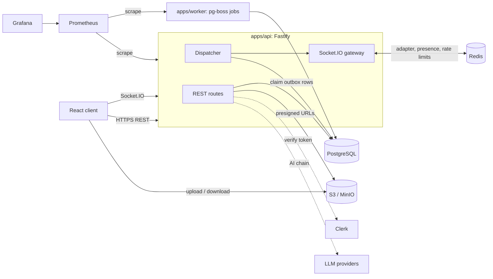
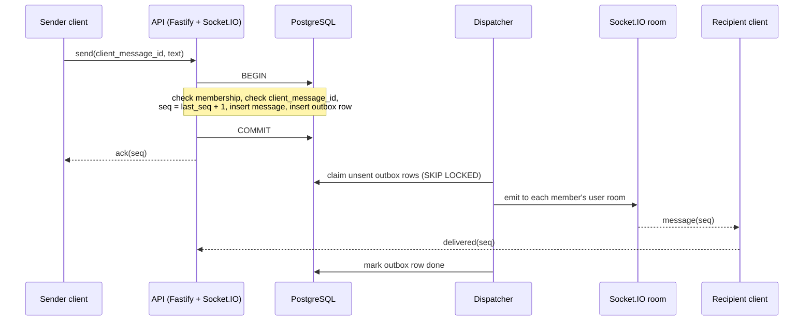
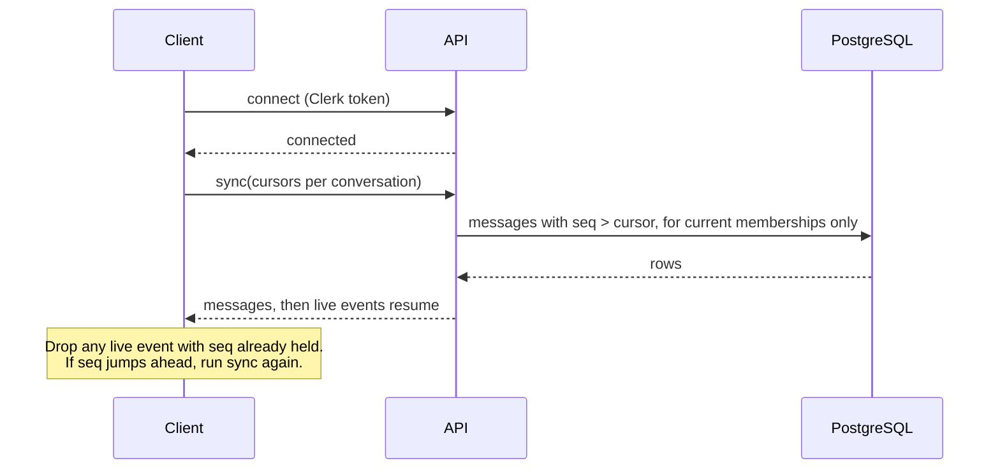

# System design: Flick

This is the design of Flick, a single-region, modular chat app. It is small on purpose. Each choice is explained in
[`../decisions/`](../decisions/README.md). What has been verified is listed in [`../status.md`](../status.md).

**Goal.** Every accepted message is stored safely, appears live when a recipient is connected, and can be recovered
after a disconnect or restart.

## 1. Requirements

**Functional.** Direct and group chat; delivered and read receipts; offline sync; presence and typing; images and
files; edit, delete, reactions, reply, forward; pin and star; search; mentions; chat organisation; polls;
disappearing messages; view-once; GIFs and stickers; link previews; voice notes with waveform; wallpapers; chat lock; the installable app; 1:1 and
group calls; Web Push; the AI assistant and @flick.

**Non-functional.**

| Need          | How it is met                                                                  |
| ------------- | ------------------------------------------------------------------------------ |
| Durability    | A message is acked only after the Postgres commit                              |
| Ordering      | A per-conversation `seq` from a row-locked counter                             |
| No duplicates | `client_message_id` plus a unique constraint; clients drop duplicates by `seq` |
| Recovery      | The sync call reads the database after any reconnect                           |
| Security      | Clerk login; membership checked on every read and write; TLS; rate limits      |
| Operability   | Prometheus metrics and Grafana dashboards; health endpoints                    |

## 2. Components



- **API** serves REST, runs the Socket.IO gateway and the dispatcher.
- **Worker** runs jobs only: Web Push for offline users, expiring messages, upload and outbox clean-up.
- **Redis** is never durable. Losing it never loses a message.
- **Calls:** 1:1 calls are peer-to-peer WebRTC with coturn for relay. Group calls and call links use LiveKit.
  Signalling for 1:1 goes through Socket.IO.

## 3. Sequences

### 3.1 Sending a message (the main path)



If the sender retries the same `client_message_id`, the transaction finds the existing message and returns its `seq`.
No second message is made.

### 3.2 Recovery by sync



Sync is the recovery path for everything: a dropped socket, an API restart, a lost event, a long offline period.

### 3.3 A restart between commit and live delivery

The message and its outbox row are committed together. If the API dies before the dispatcher emits, the row is still
unsent. After the restart the dispatcher claims it and emits. Clients that were connected also run sync on
reconnect. Nothing is lost.

### 3.4 Large groups

The dispatcher reads the current members when it dispatches and emits to their `user:<id>` rooms (in batches of 500
for groups over 256 members). Socket.IO with the Redis adapter reaches the sockets on every API replica. Offline
members are handled by sync and by Web Push jobs.

## 4. Failure boundaries

| What fails    | What happens                                                                     |
| ------------- | -------------------------------------------------------------------------------- |
| Client socket | Socket.IO reconnects; the client runs sync                                       |
| API process   | Unsent outbox rows stay in Postgres; another API or the restarted one dispatches |
| Redis         | Cross-server live delivery pauses, presence shows offline. Messages are safe     |
| Worker        | Jobs wait in Postgres and run later                                              |
| Postgres      | Sends fail with an error and are retried by the client. Nothing is acked         |
| S3 / MinIO    | Uploads and downloads fail. Text chat keeps working                              |
| Clerk         | New logins fail. Existing sockets keep working until the token expires           |
| LLM providers | The chain tries the next provider; if none work, the feature says "unavailable"  |

## 5. Scaling inside one region

1. **One API, one worker.** Everything works; the guarantees live in Postgres, not in process memory.
2. **Several API servers** behind a load balancer. The Socket.IO Redis adapter shares rooms. Dispatchers coordinate
   with `SKIP LOCKED`.
3. **Read replicas and indexes** for history and search, if reads become the limit.
4. Beyond that, see the [future roadmap](#7-future-roadmap) and the [sharding note](sharding-multi-region.md).

## 6. Capacity estimate (a hypothetical exercise)

This section is a **thought exercise**, not a measurement. Nothing here says Flick can carry this load. Measured
numbers are in [`../performance/database.md`](../performance/database.md). It uses a WhatsApp-sized scenario so the arithmetic shows
where the limits are. Units are decimal; 1 day = 86,400 s.

**Inputs (assumed).**

| Input                          | Value                                                                |
| ------------------------------ | -------------------------------------------------------------------- |
| Daily users                    | 500,000,000                                                          |
| Messages per user per day      | 40                                                                   |
| Messages per day               | 20,000,000,000                                                       |
| Peak rate                      | 700,000 msg/s                                                        |
| Concurrent connections         | 100,000,000                                                          |
| Message size                   | 200 B                                                                |
| Connections per server         | 50,000 (a guess)                                                     |
| Postgres commits per primary   | 10,000 /s (a guess)                                                  |
| Average recipients per message | 4.6 users, 7.4 devices (1.5 devices per user, 20% group chats of 20) |

**Arithmetic.**

```
average rate     = 20,000,000,000 / 86,400            = 231,481 msg/s    (peak is 3.0 x average)
API servers      = 100,000,000 / (50,000 x 0.7 load)   = about 2,860
row writes/msg   = counter update + message + outbox + mark done = 4
row writes/s     = 700,000 x 4                         = 2.8 million /s at peak
primaries needed = 700,000 / (10,000 x 0.6)            = about 117 shards
storage/message  = 200 payload + 120 row + 120 index   = 440 B
storage/day      = 20,000,000,000 x 440 B              = 8.8 TB  (26.4 TB with 2 replicas)
live deliveries  = 700,000 x 7.4                       = 5.2 million /s at peak
presence beats   = 100,000,000 / 30 s                  = 3.3 million /s
```

**What this tells us.** In order, the limits would be: (1) the row lock on one hot conversation, about
`1 / lock time` messages per second per conversation; (2) Postgres write volume, which is why conversation-based
sharding exists as a design; (3) live fan-out, which is about 7 times the message rate; (4) presence heartbeats;
(5) connection memory. The real Flick target is far smaller, and a single Postgres primary is expected to be enough.

## 7. Future roadmap

Each item is added only when a need is shown.

- **Redpanda/Kafka** when there is a second independent consumer of message events, a replay need, or measured
  dispatcher throughput that one Postgres outbox cannot meet. The outbox stays; the dispatcher publishes to a topic
  instead of a room. See [ADR-0004](../decisions/0004-inapi-dispatcher-redpanda-deferred.md).
- **End-to-end encryption** as a separate security milestone with a threat model. See
  [ADR-0011](../decisions/0011-e2e-encryption-deferred.md).
- **Sharding and multi-region** by conversation. See [`sharding-multi-region.md`](sharding-multi-region.md).
