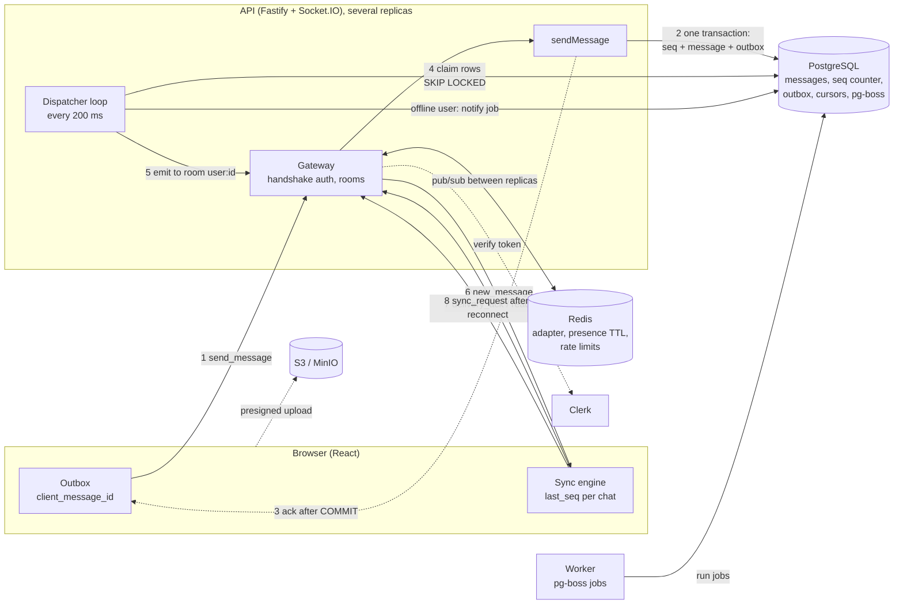
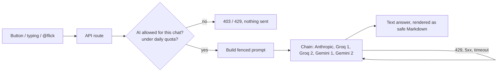

# Flick interview guide

This guide prepares you to explain Flick in an SDE-1 interview: a two-minute pitch, the one diagram to draw, thirty
likely questions with answers, "why not X" cards, honest limits, drills, and the numbers to know. Sections 8 and 9 (new)
explain the AI architecture and the album and upload designs in interview-friendly terms. Every answer was checked
against the code in this repo and points to a real file. If the guide and the code ever disagree, the code wins: fix
the guide.

Related: [`stack-rationale.md`](stack-rationale.md), [`../architecture/overview.md`](../architecture/overview.md),
[`../ai/README.md`](../ai/README.md), [`../ai/architecture.md`](../ai/architecture.md), [`../status.md`](../status.md),
[`../decisions/README.md`](../decisions/README.md).

How to use it: read sections 1 and 2 until you can say them without looking. Then do the drills in section 6.
Read section 5 last and often. It keeps you honest, and honesty is what a good interviewer rewards.

**Contents**

1. [The pitch](#1-the-pitch)
2. [The one diagram](#2-the-one-diagram-to-draw)
3. [The 30 questions](#3-the-30-questions)
4. [Why not X? cards](#4-why-not-x-cards)
5. [Traps and honest limits](#5-traps-and-honest-limits)
6. [Drills](#6-drill-list)
7. [Numbers to know](#7-numbers-to-know)
8. [Explaining the AI architecture](#8-explaining-the-ai-architecture)
9. [Explaining albums and uploads](#9-explaining-albums-and-uploads)

---

## 1. The pitch

### The 2-minute version (spoken, about 250 words)

> Flick is a WhatsApp-style chat app I built end to end. It has one-to-one chats and groups, delivery and read
> ticks, offline sync, presence and typing, media (any file up to a gigabyte, albums), voice notes, search, calls,
> push notifications, and an AI layer: writing help, translation, voice transcription, explaining images and files,
> and an assistant called Flick that you can also summon with @flick in a chat.
>
> The hard part of a chat app is not sending a message. It is never losing one, never showing one twice, and
> showing them in the same order everywhere. So I designed around that.
>
> When a client sends a message, it makes a client message id once and reuses it on every retry. The server runs
> one Postgres transaction. It takes the next sequence number for that conversation, inserts the message, and
> inserts an outbox row. Only after the commit does it ack the sender. So "accepted" always means "saved".
>
> A small dispatcher loop inside the API reads the outbox rows, looks up the current members, and emits the event
> to Socket.IO rooms. A Redis adapter lets that reach users on any API server. If anything crashes, the row is
> still in Postgres and goes out again. Delivery is at least once, and clients drop duplicates by sequence number.
>
> If a user was offline, nothing is lost. On reconnect the client sends its last sequence number for each
> conversation and the server returns everything after it. Live events are only a fast path. Postgres is the
> truth.
>
> Login is Clerk. Redis only holds disposable things: presence, rate limits, caches. Background jobs such as
> offline push notifications run on pg-boss, so a job is queued in the same transaction as the data.
>
> The AI is used in many places but it is never in the delivery path and it only runs when the user asks. Requests go
> through a provider chain with cooldowns, a per-user daily quota and a per-chat privacy switch; things like scam
> warnings run locally with plain rules.
>
> I kept it simple on purpose. There is no Kafka, because nothing needs it yet, and I can say exactly what would
> make me add it.

### The 30-second version

> Flick is a chat app. A message is saved in one Postgres transaction with a per-conversation sequence number and
> an outbox row, and only then acked. A dispatcher turns outbox rows into Socket.IO events, at least once, and the
> client drops duplicates by sequence number. After being offline, the client asks for everything after its last
> sequence number. Postgres is the truth. Redis, Socket.IO and the notifications are just helpers around it.

---

## 2. The one diagram to draw

Draw this on the whiteboard first, before the interviewer asks anything. Then walk through it with the numbers.

### Walk-through: one message, from send to read

Say these steps out loud, pointing at the diagram.

1. **Client makes a `client_message_id`.** A UUID made once, when the user presses send. It is stored in the
   browser outbox (`apps/web/src/features/chat/outbox/outboxMachine.ts`). Every retry, reconnect or reload reuses
   the same id.
2. **`send_message` over Socket.IO.** The gateway validates the payload with the zod schema from
   `@chat/contracts`, applies a per-socket token bucket, and calls `sendMessage`
   (`apps/api/src/modules/messages/domain/send.ts`).
3. **One Postgres transaction** (`allocateSeqAndInsertMessage` in `database/src/queries/messages.ts`):
   1. `UPDATE conversations SET last_seq = last_seq + 1 RETURNING last_seq`. This locks that one conversation row.
   2. `INSERT` the message with `ON CONFLICT (sender_device_id, client_message_id) DO NOTHING`.
   3. Check the sender is an active member.
   4. `INSERT` an `outbox` row (`message.created`, `partition_key` = conversation id).
   5. `COMMIT`.
      If step 2 conflicts, it is a retry: roll back (the seq bump is undone, so no gap) and return the original
      message with `duplicate: true`.
4. **Ack after commit.** The sender gets `{ seq, message_id, duplicate }`. The ack callback runs only after the
   transaction resolved.
5. **Dispatcher** (`apps/api/src/modules/dispatcher/index.ts`): every 200 ms, claim up to 100 unsent outbox rows
   with `FOR UPDATE SKIP LOCKED`.
6. **Recipients are read from Postgres now** (`dispatch.ts: activeMembers`), then
   `io.to("user:<id>").emit("new_message")`. The sending device is excluded; the sender's other devices get it.
7. **Socket.IO rooms + Redis adapter.** Each user has a room `user:<id>`. The adapter forwards the emit to every
   API replica, so it does not matter which replica holds the socket.
8. **Row marked done** (`published_at = now()`) in the same transaction that claimed it, after the emit worked.
   Users with no socket on any replica get a pg-boss `notify` job (unless muted).
9. **Client receives it.** The sync engine (`apps/web/src/features/chat/sync/merge.ts`) compares `seq` with its
   `last_seq`: old means drop, next means apply, a jump means a gap, so run sync.
10. **Delivery ack.** The device sends `delivery_ack(seq)`. The server moves `device_cursors.delivered_seq`
    forward only. The sender sees two ticks.
11. **Read cursor.** When the user looks at the chat, the client sends `read_ack(seq)`. The server moves
    `conversation_members.read_seq` forward only. The sender sees blue ticks.
12. **Sync on reconnect.** After any disconnect the client sends `sync_request` with `{conversation_id, after_seq}`
    for every chat. The server returns everything after, in seq order, in pages
    (`apps/api/src/modules/messages/domain/sync.ts`). Live events that arrive meanwhile are buffered and merged.

---

## 3. The 30 questions

Format for each: **Short answer**, **Why**, **Point at**, **Follow-up**.

### A. System design

**Q1. Walk me through the architecture.**

- **Short answer.** React client, Fastify API that also hosts the Socket.IO gateway and a dispatcher loop, one
  PostgreSQL database as the source of truth, Redis for disposable state, a separate worker for pg-boss jobs, S3
  (MinIO locally) for media, Clerk for login. It is a modular monolith: one deployable API, split into modules.
- **Why.** One team, one product, one database. A monolith with clear module borders is easy to run and easy to
  explain. I can split it later without changing the protocol (ADR-0009).
- **Point at.** `docs/architecture/overview.md`, `apps/api/src/modules/` (auth, messages, conversations, gateway,
  dispatcher, media, calls, ai), `apps/worker/src/jobs/`.
- **Follow-up: "Why is the dispatcher inside the API and not a separate service?"** There is one consumer of the
  events (the gateway), and it needs the Socket.IO server object to emit. A separate process would need a broker to
  reach the sockets. If the loop ever uses too much CPU, I move it to its own process. Nothing else changes
  (ADR-0004).

**Q2. Why WebSockets (Socket.IO) and not polling or SSE?**

- **Short answer.** Chat needs messages both ways with low delay. WebSockets give that. Polling wastes requests and
  adds delay. SSE is one-way, so I would still need a second channel for sending.
- **Why.** The cost is stateful connections: servers must know where each socket lives. Socket.IO's rooms plus the
  Redis adapter hide that. I use only the `websocket` transport (no long-polling), so I need no sticky sessions.
- **Point at.** `apps/api/src/ws.ts` (adapter), `apps/api/src/modules/gateway/index.ts`,
  `apps/web/src/lib/realtime/socketTransport.ts` (`transports: ['websocket']`).
- **Follow-up: "Why Socket.IO and not raw `ws`?"** Socket.IO gives reconnect with backoff, heartbeats, rooms and
  acknowledgement callbacks. With raw `ws` I would have to write all four, and I would get them wrong. The costs
  are a bigger client and a protocol on top of WebSocket, so only Socket.IO clients can talk to it (ADR-0001).

**Q3. How does a message reach a user who is connected to a different server?**

- **Short answer.** The dispatcher emits to the room `user:<id>`. The Socket.IO Redis adapter publishes that emit
  on Redis pub/sub, and every API replica delivers it to its own sockets in that room. The dispatcher does not need
  to know which replica holds the user.
- **Why.** It is much simpler than my own "which server has which user" map. Redis here is only a pipe. If a pub/sub
  message is lost, the client finds the message through sync.
- **Point at.** `apps/api/src/ws.ts` (`createAdapter`), `docs/architecture/overview.md` (gateway section).
- **Follow-up: "What if Redis is down?"** Cross-replica live emits stop. Messages are still stored in Postgres and
  clients recover through sync. The HTTP rate limiter lets requests through (`skipOnError`). Nothing is lost
  (ADR-0005).

**Q4. How do you handle a group of 1,000 members?**

- **Short answer.** One message row, however many members. The dispatcher reads the member list, and emits to
  `user:<id>` rooms. Up to 256 members it emits in one pass. Above that, in batches of 500, yielding to the event
  loop between batches. The group maximum is 1,024.
- **Why.** The cost of a send stays one insert plus one outbox row. Fan-out is cheap work in memory. The batching
  stops one big group from blocking the event loop for other users.
- **Point at.** `packages/contracts/src/limits.ts` (`INLINE_FANOUT_MAX_MEMBERS`, `FANOUT_BATCH_SIZE`),
  `apps/api/src/modules/dispatcher/dispatch.ts: inBatches`.
- **Follow-up: "And 10,000 members?"** Not supported (cap is 1,024). The thresholds are design defaults, not
  measured. For 10,000, I would still store one row, but fan out in a separate job, send only a light "new message
  in chat X" hint, and let clients fetch. I would measure first. See drill 3.

**Q5. What is the @flick bot, and how does it work?**

- **Short answer.** When a message mentions @flick, the dispatcher hands it to the bot hook after delivering it.
  The bot builds a short transcript (last 20 messages, trimmed), asks the AI provider chain, and posts the reply as
  an ordinary message from a seeded bot user. So the reply gets a seq and goes through the outbox like any other.
- **Why.** Reusing the normal send path means the bot needs no special delivery code. Guards: it ignores bots (no
  reply loops), is rate limited (5 per minute per user, 10 per conversation) and treats the chat text as untrusted
  data in the prompt.
- **Point at.** `apps/api/src/modules/ai/bot.ts: flickBotOnMessage`, `database/src/bot.ts`
  (`FLICK_BOT_USER_ID`), `packages/ai/src/chain.ts`.
- **Follow-up: "What if the AI is down?"** Providers are tried in a fallback chain with cooldowns (ADR-0014). If all
  fail, the bot posts one short "unavailable" notice. The live AI reply has not been run in this repo (no keys in
  tests), only unit and integration tests with fakes.

### B. Database

**Q6. Why PostgreSQL and not MongoDB?**

- **Short answer.** A send must change several things atomically: the seq counter, the message and the outbox row.
  Postgres has real transactions, unique constraints and foreign keys, so the database enforces the rules.
- **Why.** In MongoDB I would have to build the "message plus event" guarantee myself. I also use full-text search
  (`tsvector` + GIN index), row locks and partial indexes. MongoDB has multi-document transactions, but the
  relational model fits memberships and cursors better. 
- **Point at.** `database/migrations/0002_messaging.ts`, `docs/decisions/0002-postgresql-canonical-store.md`.
- **Follow-up: "Would MongoDB be wrong?"** No. It would work. I chose Postgres because the delivery guarantees
  come from constraints and transactions, which is what Postgres is best at.

**Q7. How do you order messages, and why a counter and not timestamps?**

- **Short answer.** Each conversation has `conversations.last_seq`. Every change (message, edit, delete, reaction)
  does `last_seq = last_seq + 1` inside the send transaction. `(conversation_id, seq)` is unique. Clients sort by
  `seq`.
- **Why.** Timestamps are wrong: device clocks drift and ties happen. A counter also gives gap detection: if I
  have 41 and receive 43, I know 42 is missing.
- **Point at.** `database/src/queries/messages.ts: allocateSeqAndInsertMessage`,
  `docs/decisions/0007-per-conversation-ordering-row-lock.md`.
- **Follow-up: "Why not a Postgres SEQUENCE?"** A sequence is not transactional. A rolled-back value leaves a hole,
  and values can become visible out of order. My counter is a normal column, so a rollback undoes the increment
  and the numbers have no holes. (Note: the counter is a column, not a `SEQUENCE` object. Say it exactly.)

**Q8. What does the row lock cost? What is the limit?**

- **Short answer.** Sends to the same conversation take turns, because the `UPDATE` holds the row lock until commit.
  Different conversations do not wait on each other. A very busy single conversation is capped by how long that
  transaction takes.
- **Why.** I trade a little throughput on a hot chat for a simple, correct, gap-free order. Normal chats send a few
  messages a second at most. I keep the transaction short and make no network calls inside it.
- **Point at.** ADR-0007 "Trade-offs", `docs/architecture/delivery-guarantees.md` section 11.
- **Follow-up: "What is the cap?"** The measured value, with the machine and method, is in `docs/performance/database.md`;
  quote it with its date and say it was a laptop.

**Q9. What indexes does the messages table need?**

- **Short answer.** A unique index on `(conversation_id, seq)`, used by history and sync. A unique index on
  `(sender_device_id, client_message_id)` for idempotency. A GIN index on the `search` tsvector. Partial indexes for
  active members and for expiring messages.
- **Why.** History and sync read "the next page by seq", which is an index range scan. I use keyset pagination
  (`seq < cursor` or `seq > cursor`), never `OFFSET`, so page 1,000 costs as much as page 1, and new messages
  cannot shift the pages.
- **Point at.** `database/migrations/0002_messaging.ts`, `database/src/queries/messages.ts: buildHistoryQuery`.
- **Follow-up: "Did you check it with EXPLAIN ANALYZE?"** Say honestly what you did. The indexes are designed for
  those queries. If you have not run EXPLAIN ANALYZE on a big table yet, say so and say you would.

**Q10. Why are delivered and read separate cursors, not one status per message?**

- **Short answer.** `delivered_seq` lives per device (`device_cursors`), `read_seq` lives per user
  (`conversation_members`). Each is one number per conversation: "everything up to here". They only move forward
  (`GREATEST`).
- **Why.** One row per message per recipient would be huge in groups. "Delivered" is a fact about a device (my phone
  has it, my laptop does not yet). "Read" is a fact about a person. Because cursors only go forward, a repeated or
  late ack cannot break anything.
- **Point at.** `apps/api/src/modules/messages/domain/receipts.ts`, `database/src/queries/cursors.ts`,
  `docs/architecture/delivery-guarantees.md` "Receipts".
- **Follow-up: "How are group ticks shown?"** The sender sees "delivered" or "read" when every other member's cursor
  has passed the message. It is coarse in big groups. That is a known limit.

**Q11. How do you page through history safely?**

- **Short answer.** By seq, not offset: `seq < N ORDER BY seq DESC LIMIT n`. One extra row is fetched to know if
  there is another page, so there is no `COUNT`.
- **Why.** Offset gets slower on deep pages and skips or repeats rows when new data arrives. A seq cursor never
  does. In sync, messages and message events are read in one SQL statement, so each page is one snapshot.
- **Point at.** `database/src/queries/messages.ts: keysetHistory`, `apps/api/src/modules/messages/domain/sync.ts`.
- **Follow-up: "Can a row appear later behind the cursor?"** No. A seq becomes visible only after every lower seq
  has committed, because of the row lock.

### C. Real-time

**Q12. How does presence work across several devices?**

- **Short answer.** Redis holds, per user, a sorted set of socket ids. The score is the time that entry expires
  (60 s). The server refreshes live entries every 20 s. A user is online if at least one entry has not expired.
  When the last socket leaves, `users.last_seen_at` is written and `presence_update` goes to the room
  `presence:<id>`.
- **Why.** Aggregating over sockets means a user with phone and laptop stays online until both leave. The TTL means
  a crashed server's entries run out by themselves. There is no cleanup job.
- **Point at.** `apps/api/src/modules/gateway/presence.ts`, `gateway/index.ts` (`presence_subscribe`).
- **Follow-up: "Who can see my presence?"** Only people who share a conversation with me
  (`usersSharingConversation`). Last seen is hidden unless my privacy setting is "everyone". Limit: after a server
  crash, a user may look online for up to 60 s.

**Q13. How does the Clerk token work in the socket handshake, and how does it refresh?**

- **Short answer.** The client puts `{ token, deviceId }` in the handshake `auth` object, never in the URL. In the
  client, `auth` is a function, so every connect and every reconnect calls Clerk for a fresh token. The server
  verifies the token with `verifyToken` and loads the local user.
- **Why.** Clerk session tokens are short-lived. Using a function means a reconnect after a long sleep does not
  send a stale token. The server verifies the token only at handshake.
- **Point at.** `apps/web/src/lib/realtime/socketTransport.ts` (`auth: (cb) => ...`),
  `apps/api/src/modules/gateway/index.ts` (`io.use`), `apps/api/src/modules/auth/authenticate.ts`,
  `apps/api/src/modules/auth/clerk.ts`.
- **Follow-up: "So an open socket outlives the token?"** Yes. I do not re-verify an open socket. Banning a user
  takes effect on their next connection or HTTP call. The auth lookup is cached in Redis for 300 s, so a disabled
  user can also keep working up to 5 minutes. That is a known, documented limit.

**Q14. What does the client do when events arrive out of order or twice?**

- **Short answer.** It keeps `last_seq` per conversation, and compares each event's seq. At or below `last_seq`
  means duplicate: drop. Exactly `last_seq + 1` means apply. Higher means a gap: stop and sync that conversation.
- **Why.** This makes the client idempotent: dispatcher retries, two replicas, and live-vs-sync overlap all become
  harmless. The merge is a pure function, tested for any order of events.
- **Point at.** `apps/web/src/features/chat/sync/merge.ts: mergeEvents`, `syncEngine.ts`.
- **Follow-up: "Why dedupe by (conversation_id, seq) and not by message id?"** Edits, deletes and reactions are
  events too and share the same seq space. One number per conversation tells me about all of them, and about
  holes. Message id alone would not detect a missed edit.

**Q15. What happens after a reconnect?**

- **Short answer.** Socket.IO reconnects with exponential backoff (about 0.5 s up to 30 s, with jitter). On connect
  the client runs `sync_request` with its last seq per conversation. The server answers page by page. Live events
  that arrive during the sync are buffered, then merged.
- **Why.** The server puts the socket in its rooms before sync, so live events flow during sync. They may overlap
  the pages but can never fall into a hole, because seqs are dense. Whatever is missed shows as a gap.
- **Point at.** `apps/web/src/features/chat/sync/syncEngine.ts` (header comment explains buffering),
  `sync.ts: syncMany`.
- **Follow-up: "How do you stop a never-ending resync?"** After 4 rounds with a gap that does not heal, the client
  gives up on that conversation (`MAX_ROUNDS`) instead of looping forever.

### D. Reliability

**Q16. What is the outbox, and why use it?**

- **Short answer.** It solves the dual-write problem. I must save the message in Postgres and also tell the
  sockets. If I do both separately, a crash between them loses one. So I write an `outbox` row in the same
  transaction as the message. A separate loop sends it later.
- **Why.** The database commit is the single source of truth. Either the message and its event both exist, or
  neither does.
- **Point at.** `database/src/queries/messages.ts` (outbox insert), `docs/decisions/0003-transactional-outbox.md`.
- **Follow-up: "Could you just emit right after the commit?"** If the process dies between commit and emit, the
  event is lost forever. Sync would still recover it for the receiver, but ticks, notifications and the bot would
  be skipped. The outbox makes that case safe.

**Q17. What if the dispatcher crashes after emitting but before marking the row done?**

- **Short answer.** The row is still unpublished, because "mark done" and the claim are one transaction that never
  committed. After restart, the row is claimed and emitted again. Clients drop it because they already hold that
  seq. That is the "at least once".
- **Why.** I choose "maybe twice" over "maybe never". Duplicates are cheap to remove. Losses are not.
- **Point at.** `apps/api/src/modules/dispatcher/index.ts: runOnce`, test: `apps/api/test/integration/gate.int.test.ts`
  (gate 3: "emitted-but-not-marked row is emitted again and deduped").
- **Follow-up: "What about the second push notification?"** The notify job id is a fixed hash of
  `(event_id, user_id)`. A job id is a primary key, so the second insert does nothing
  (`dispatch.ts: notifyJobId`). I found this in testing: `singletonKey` did not prevent it on a standard queue.

**Q18. What is your delivery guarantee? Why not exactly-once?**

- **Short answer.** At-least-once delivery, shown once to the user. Idempotency (the client message id plus the
  unique constraint) removes duplicates on send. Client dedupe by seq removes them on receive.
- **Why.** A sender cannot tell "not delivered" from "delivered but the ack was lost". So it must retry, and a
  retry can duplicate. True exactly-once across a network is not possible. Effectively-once is: make every retry
  harmless.
- **Point at.** `docs/architecture/delivery-guarantees.md`, ADR-0008.
- **Follow-up: "What does a retry do?"** The second insert hits `ON CONFLICT`, the transaction rolls back (so no seq
  gap) and the server returns the original `message_id` and `seq` with `duplicate: true`.

**Q19. What breaks if two API servers run the dispatcher?**

- **Short answer.** Nothing is lost and no row is taken twice at the same moment. `FOR UPDATE SKIP LOCKED` gives
  each replica a different batch. Duplicates are still safe. The one real effect: two replicas can emit events of
  the same conversation in a slightly different order.
- **Why.** Replica 1 holds the lock on rows 1-100. Replica 2 skips them and may claim row 101 and emit it first.
  The client sees a seq above `last_seq + 1`, treats it as a gap, and syncs. So order for the user is still by
  seq. Strict emit order is not guaranteed, user-visible order is. (This is my reading of the code; it is not
  separately tested.)
- **Point at.** `database/src/queries/outbox.ts: buildOutboxClaimQuery`, `dispatcher/index.ts`.
- **Follow-up: "Is that a problem?"** It costs an extra sync now and then. If it mattered, I would route by
  conversation (one claimer per partition key) or use a broker with keyed partitions. That is one of the reasons
  Kafka could come later.

**Q20. How is a removed member stopped from receiving messages?**

- **Short answer.** Four checks, all against Postgres: send checks membership, the dispatcher reads current members
  for every outbox row, history requires membership, sync requires membership (a removed conversation comes back in
  `removed_conversation_ids`). Sockets are in per-user rooms, not per-conversation rooms, so there is no stale room
  to forget to leave.
- **Why.** Membership is never cached, so there is no window where a removed user still gets events.
- **Point at.** `dispatch.ts: activeMembers`, `sync.ts: syncMany`, test gate 5 in `gate.int.test.ts`.
- **Follow-up: "What about messages they already got?"** The server does not recall them. A removed member keeps
  whatever their client already stored. Say this before the interviewer asks.

**Q21. How does the notify job avoid sending twice, and what if the worker is down?**

- **Short answer.** The dispatcher checks which recipients have a socket on any replica
  (`fetchSockets`). Offline, unmuted users get one pg-boss job with a deterministic id. The job is written in the
  same transaction that marks the outbox row done. The worker re-checks (deleted? muted? online now?) before it
  sends a push.
- **Why.** A job is a row in Postgres, so it commits with the data. With Redis (BullMQ) a crash between the two
  writes would lose the job or create one for a rolled-back message. If the worker is down, jobs wait in Postgres.
- **Point at.** `dispatch.ts: newMessage`, `apps/worker/src/jobs/notify.ts: handleNotify`,
  `docs/architecture/overview.md` (worker section).
- **Follow-up: "What if one of the user's two browsers fails?"** The retry may send to the other browser again. The
  payload has `message_id`, so the service worker can use it as the notification `tag` and show it once.

### E. Security

**Q22. How does login work? Did you write the auth yourself?**

- **Short answer.** No. Clerk handles sign-up, passwords and sessions. My API verifies the Clerk session token
  (`verifyToken`, with `authorizedParties` set to my web origins) and maps the Clerk user id to a local `users` row,
  created on first sight. A device is a client-made UUID, created on first use and refused if it belongs to another
  user.
- **Why.** Writing auth is a risk with no upside for a chat app. Clerk removes password storage, reset flows and
  token rotation from my scope. The cost is a dependency and a vendor.
- **Point at.** `apps/api/src/modules/auth/authenticate.ts`, `clerk.ts`, `docs/security/auth.md`, ADR-0010.
- **Follow-up: "What is `fake-clerk.ts`?"** A test-only login for Playwright and k6, switched on by
  `E2E_FAKE_AUTH=true`. The config refuses that setting in production. Explain this before someone finds it.

**Q23. Are messages encrypted?**

- **Short answer.** In transit, yes (TLS). On the server they are plaintext in Postgres. There is no end-to-end
  encryption. Access is protected by authorization: membership checks on every read and write.
- **Why.** Plaintext lets the server do full-text search, moderation and the AI bot. E2E would take those away and
  needs key management and multi-device handling. I decided it was out of scope (ADR-0011).
- **Point at.** `docs/decisions/0011-e2e-encryption-deferred.md`.
- **Follow-up: "How would you add it?"** See section 5. Short version: Signal protocol library, device keys, server
  stores ciphertext only, and search moves to the client.

**Q24. How do you protect the link-preview feature from SSRF?**

- **Short answer.** The server fetches URLs that users paste, which is dangerous. The fetcher denies anything that
  is not plainly public: it resolves DNS itself, rejects private, loopback, link-local (cloud metadata
  169.254.169.254), CGNAT, IPv4-mapped, NAT64, 6to4 and Teredo ranges, and re-validates the resolved address at
  connect time (a pinned lookup), so a DNS rebind cannot swap it. It also limits redirects (3), body size
  (512 KiB) and total time, and re-checks every redirect.
- **Why.** An allow-list of "global unicast only" is safer than a deny-list of bad ranges. Unwrapping mapped
  addresses is where most SSRF filters fail, so I refuse them.
- **Point at.** `packages/link-preview/src/ip.ts`, `fetcher.ts`, `url.ts`.
- **Follow-up: "Is it tested against a real attacker?"** There are unit tests. The link previews were not
  exercised against real external services (see `docs/status.md`). Do not claim a pen test.

**Q25. How do media uploads work, and how do you rate-limit?**

- **Short answer.** Uploads: the API records the intent and returns a presigned POST; the browser uploads straight
  to S3/MinIO (10 minute URL, size and content type enforced by S3). The server then sniffs the file and attaches it
  to a message only if the sender owns it. A job deletes uploads stuck in `pending` after 24 hours. Rate limits:
  HTTP is 300 requests per minute per IP, counted in Redis so it holds across replicas. Sockets use an in-memory
  token bucket per socket (40 burst, 20 per second). The bot has its own limits.
- **Why.** Bytes never pass through my API, so big files do not tie up Node. In-memory buckets are per process, which
  is fine for a per-socket limit. Shared limits need Redis.
- **Point at.** `apps/api/src/modules/media/domain/uploads.ts`, `apps/api/src/app.ts` (rate-limit plugin),
  `gateway/rate-limit.ts`, `apps/worker/src/jobs/sweep-uploads.ts`.
- **Follow-up: "What if Redis is down?"** The HTTP limiter fails open (`skipOnError`), so users are not locked
  out. The cost is that limits stop working until Redis returns.

### F. Scaling

**Q26. How would you scale this 100 times?**

- **Short answer.** First, measure. Then in order: more API replicas (already designed for it, no sticky
  sessions), Postgres read replicas for history, a connection pooler, move the dispatcher and worker to their own
  processes, partition old messages by time. Then shard by `conversation_id`.
- **Why.** Every send touches exactly one conversation, so `conversation_id` is a natural shard key. A conversation
  never moves, so its seq order is never split. Ordering stays per conversation, and that is all I need.
- **Point at.** `docs/architecture/sharding-multi-region.md` (a design note; nothing in it is built).
- **Follow-up: "What gets harder with shards?"** The conversation list per user, search across chats, resharding
  while sends continue, and cross-shard work such as creating a direct chat. Say that you know these exist.

**Q27. What would you monitor, and what would page you?**

- **Short answer.** `outbox_oldest_age_seconds` and `outbox_pending` (is the dispatcher keeping up),
  `message_dispatch_latency_seconds` (commit to emit), `ws_connections_active`, `ws_connect_attempts_total`, the
  database pool, HTTP latency by route, and rate-limit rejections. An old outbox row is the most important alert.
- **Why.** The outbox age is the one number that says "messages are saved but not being delivered".
- **Point at.** `apps/api/src/metrics.ts`, `dispatcher/index.ts`
  (`updateBacklogMetrics`), `infra/` (Prometheus and Grafana).
- **Follow-up: "Have you seen the dashboards with real data?"** The metric names were checked against the code, but
  the values were not checked in a running Prometheus (status doc). Say so.

### G. Tooling and trade-offs

**Q28. Why Fastify and not Express? Why pg-boss and not BullMQ?**

- **Short answer.** Fastify has built-in schema validation and encapsulated plugins and is fast; Express is more
  common, and I know that. I use Fastify for REST and attach Socket.IO to its server. pg-boss stores jobs in
  Postgres, so a job can be queued in the same transaction as the data. BullMQ lives in Redis and cannot.
- **Why.** Fastify: fewer dependencies for validation, rate limit and helmet. pg-boss: one less service to run,
  and Redis stays disposable.
- **Point at.** ADR-0015, ADR-0006, `apps/worker/src/jobs/boss.ts`.
- **Follow-up: "When would BullMQ win?"** Very high job throughput (thousands per second) or delayed-job features
  at scale. Postgres as a queue has a ceiling.

**Q29. How is the project tested, and what is not tested?**

- **Short answer.** Unit tests, and integration tests against real Postgres, Redis and MinIO containers. Six
  "gates" prove the delivery contract: duplicate sends make one message, concurrent sends get unique ordered seqs,
  restart after commit still delivers, an offline client recovers everything, removed members get nothing,
  receipts are monotonic and separate.
- **Why.** I tested the behaviours an interviewer would ask about, not hundreds of permutations.
- **Point at.** `apps/api/test/integration/gate.int.test.ts`, `docs/status.md`.
- **Follow-up: "What is not tested?"** Two API replicas under load, a Redis outage during traffic, real Clerk, real
  Web Push, and the dashboards in a live Grafana (the status doc lists this). Say it before you are asked.

### H. What would you change

**Q30. What would you do differently, and what does not scale?**

- **Short answer.** Four things. One: plaintext on the server, so a database leak exposes messages. Two: one
  Postgres primary and a row lock per conversation set the ceiling. Three: the dispatcher shares the API
  process and has no replay log, so recovery after a long outage is by sync. Four: group receipts are coarse.
- **Why.** Each was a conscious trade for simplicity, and each has a documented next step.
- **Point at.** `docs/architecture/delivery-guarantees.md` section 11 and 12, `docs/architecture/sharding-multi-region.md`.
- **Follow-up: "What would you do first?"** Measure the hot-conversation lock and the dispatcher throughput with
  k6. Then decide: move the dispatcher out of the API, or add a broker.

---

## 4. Why not X? cards

Template for each: the requirement, why the other option falls short, the cost of what I chose, and the trigger to
switch. Keep the tone humble. The goal is to show you chose, not copied.

**Why not Kafka / Redpanda?**

- **Answer.** I have one consumer of message events: the Socket.IO gateway. A broker would add topics, partitions,
  consumer groups, dead-letter topics and a dedup table, for no gain yet. The transactional outbox gives me the
  same safety. Only the last step ("emit to rooms") would become "publish to a topic".
- **Cost of my choice.** The dispatcher shares CPU with the API. There is no replay log.
- **Switch when.** A second independent consumer appears (search indexing, analytics), history must be replayed
  into a new system, or measured throughput exceeds what one Postgres outbox can do (ADR-0004).
- **Know it anyway.** Order holds per partition, keyed by conversation id. Rebalances cause reprocessing, so
  consumers must be idempotent. Consumers commit offsets after processing. I did not build this, but I can draw it.

**Why not raw WebSockets (`ws`)?**

- **Answer.** Socket.IO gives reconnect with backoff, heartbeats, rooms, acks and a Redis adapter. I would have to
  write each of those, and bugs there break the whole app.
- **Cost.** Heavier client, and a non-standard protocol on top of WebSocket.
- **Switch when.** Non-browser clients that cannot use Socket.IO, or a measured per-connection overhead problem.

**Why not Express?**

- **Answer.** Fastify validates schemas, has encapsulated plugins and is faster, with fewer extra packages.
- **Cost.** Express is more common and has more tutorials and middleware.
- **Switch when.** Never for performance. I would switch only for team familiarity.

**Why not MongoDB?**

- **Answer.** I need atomic message plus outbox, unique constraints and per-conversation counters. Postgres does
  these natively. 
- **Cost.** A fixed schema and migrations.
- **Switch when.** The data became document-shaped and joins disappeared. Not here.

**Why not BullMQ / Redis for jobs?**

- **Answer.** A Redis job cannot be queued in the same transaction as the message. pg-boss can.
- **Cost.** Postgres as a queue has a ceiling.
- **Switch when.** Job volume is high enough to hurt Postgres, or I need Redis-only features.

**Why not a Postgres `SEQUENCE` or timestamps for ordering?**

- **Answer.** Sequences leave holes on rollback and can become visible out of order. Timestamps drift and tie.
- **Cost.** My counter takes a row lock per send in that conversation.
- **Switch when.** A single conversation needs more sends per second than the lock allows. Then batch or relax.

**Why not Redis pub/sub or Redis Streams as the message store?**

- **Answer.** That makes Redis hold data I cannot lose. Redis can lose data on restart. It is only a pipe and a
  cache here (ADR-0005).
- **Cost.** A TTL-based presence is approximate.
- **Switch when.** Never as the source of truth.

**Why not custom auth (JWT, refresh tokens)?**

- **Answer.** An earlier plan had custom auth (argon2, JWT, refresh rotation with reuse detection). I replaced it with Clerk
  before building it, because auth is high risk and low value to rewrite. I can still explain how rotation works.
- **Cost.** A vendor dependency, and an outage at Clerk blocks new logins.
- **Switch when.** Cost, data residency rules, or a need Clerk cannot meet.

**Why not end-to-end encryption?**

- **Answer.** It removes server search, moderation and the AI bot, and multi-device keys are hard. I chose
  plaintext on the server with TLS plus authorization, and I say so clearly (ADR-0011).
- **Switch when.** Privacy is the product's main promise.

**Why not microservices?**

- **Answer.** One team and one database. A modular monolith gives module borders without network calls between
  them (ADR-0009).
- **Switch when.** Teams need to deploy independently, or one module has very different scaling needs. The
  gateway and the worker would be the first to split.

**Why not sticky sessions / long-polling fallback?**

- **Answer.** With only the WebSocket transport, any replica can take any client. The adapter handles the rest.
- **Cost.** Clients behind proxies that block WebSocket cannot connect.
- **Switch when.** Real users report that WebSocket is blocked for them.

---

## 5. Traps and honest limits

### Things NOT to claim

- **No end-to-end encryption.** Messages are plaintext on the server. Never say "secure messaging" without
  "TLS plus authorization, not E2E".
- **Kafka/Redpanda is not in the build.** The outbox is read by an in-API dispatcher. If you see Kafka mentioned in an old note, `docs/decisions/` wins. `publishOutboxBatch` and
  `markEventProcessed` in the database package exist but are unused by the apps.
- **Clerk is on development keys for the demo.** Real Clerk has never been run against the automated tests (they
  use a fake client). Do not say "production auth".
- **Do not quote load numbers unless you have measured them.** Database figures exist in `docs/performance/database.md`; there are no end-to-end load figures. See
  section 7.
- **Not exactly-once.** It is at-least-once delivery plus idempotency.
- **Postgres "sequences".** Say "a per-conversation counter column", not "a Postgres sequence".
- **"Delivered" in the metric** `messages_delivered_total` means "the recipient had a socket when we emitted", not
  "the client acked".

### What is untested or unverified (from `docs/status.md`)

- Behaviour with two API replicas under load.
- A Redis outage during traffic.
- Real Clerk, real Web Push, real GIPHY, and the full AI chain against every real provider at once.
- Dashboards and alerts against a running Prometheus and Grafana.
- Load behaviour: there are no load tests, only database benchmarks.
- Chat is not end-to-end encrypted, and uploaded files are not virus scanned (served safely instead, ADR-0018).
- Star and unpin-by-others send no seq. The chat lock hash is never checked by the server (UI convenience only).
- A connected socket is not re-verified after the Clerk token expires.

### How to say "I did not build that, but here is how I would"

Use this shape: **"I did not build X. The reason is Y. If I did, I would do A, B, C. The hard part is Z."**

**End-to-end encryption.**
I did not build it. It removes server search and the bot. I would use an audited Signal protocol library (X3DH
and Double Ratchet), never my own crypto. Each device has keys; the server stores only ciphertext and public
prekeys. Groups use sender keys. The hard part is multi-device (each message encrypted per device), key changes,
and search that moves to the client.

**Sharding.**
I did not build it. I would shard by `conversation_id`, with virtual buckets mapped to shards so I can move a
bucket. The send transaction touches one conversation, so it stays on one shard. User data goes in a small
directory database. The hard part is the per-user conversation list, cross-chat search and resharding live.

**Multi-region.**
I did not build it. I would keep one home region per conversation (one writer per counter), replicate for reads,
and route clients to the nearest gateway. The hard part is that the seq counter needs one writer, so a chat with
members in two regions pays cross-region latency for sends.

**Exactly-once.**
I do not claim it. I would explain it as at-least-once delivery plus idempotent processing. Sender: stable
`client_message_id` plus a unique constraint. Receiver: dedupe by seq. For a consumer with side effects:
record the event id in the same transaction as the side effect (this is what `markEventProcessed` does).

**Kafka.**
I did not build it. I would keep the outbox, add a publisher that sends rows to a topic keyed by conversation id
(so order holds per partition), and make the gateway a consumer in a consumer group. Consumers must be
idempotent, because rebalances cause reprocessing.

---

## 6. Drill list

Do each on paper, out loud, in under 3 minutes. The key points are what a good answer contains.

1. **Draw the outbox flow.**
   Client, transaction (counter, message, outbox), commit, ack, dispatcher claims, emits, marks done. Mark the two
   crash points: before commit (client retries), after emit but before mark (re-emit, client dedupes).
2. **What breaks if two servers run the dispatcher?**
   `SKIP LOCKED` gives different batches. Duplicates are safe. Emit order of one conversation may differ between
   servers, so the client sees a gap and syncs. Fix if needed: one claimer per partition key, or a keyed broker.
3. **Design group fan-out for 10,000 members.**
   Keep one message row. Do not fan out inside the request. Fan out in a job or batched loop. Emit a small "new
   message" hint and let clients pull via sync. Receipts become counts, not per-member ticks. Measure the lock
   and the batch time first.
4. **A user is offline for 3 days. What happens when they open the app?**
   Reconnect, handshake with a fresh Clerk token, `sync_request` with last seq per chat, server pages through
   events (default 200, max 500), edits and deletes come as events, removed chats come back in
   `removed_conversation_ids`. A push notification was only a hint.
5. **Two people send at the same moment in one chat.**
   Both run `UPDATE ... last_seq + 1`. The second waits for the first commit. Seqs are 41 and 42, no hole. Both
   clients order by seq.
6. **The ack is lost and the client retries.**
   Same `client_message_id`. Insert conflicts on `(sender_device_id, client_message_id)`. Transaction rolls back
   (seq returned). Server replies with the original seq and `duplicate: true`. One message.
7. **A member is removed while a message is being dispatched.**
   Recipients are read at dispatch time from Postgres, so the removed member gets nothing new. They get
   `conversation_updated` with `conversation: null`. Their sync is refused. Messages already on their device
   stay.
8. **Redis dies for five minutes.**
   Stored messages are safe. Cross-replica live emit stops, so users on other replicas see nothing live. Presence
   stops updating. Auth cache is skipped (more DB reads). The HTTP limiter fails open. After Redis returns,
   clients sync. ADR-0005 says a test covers "a message sent while Redis is down is stored and recovered". Check that
   test exists before you claim it (I did not find it by name in `apps/api/test/integration`). Behaviour under
   traffic is not verified.
9. **Show how the notify job avoids a double push.**
   Dispatcher finds offline unmuted users. Job id = hash of `(event_id, user_id)`, a primary key. Re-dispatch
   inserts the same id, so nothing. Worker re-checks deleted, muted, online before sending. 404 or 410 from the
   push service disables that subscription.
10. **Add "edit message" and keep every device consistent.**
    Check the sender (there is no time limit). Take the next seq. Write a `message_events` row and an outbox row in
    one transaction. Dispatcher emits `message_edited` to all members. Sync replays it as an event. If the message
    was deleted later, sync replays a delete at that seq instead of the stale edit.

---

## 7. Numbers to know

All values are read from the repo, not from memory. They are **design defaults, not measured capacities.**

### Message and size limits (`packages/contracts/src/limits.ts`)

| Item                         | Value                          |
| ---------------------------- | ------------------------------ |
| Max Socket.IO message        | 1 MiB                          |
| Max text length / caption    | 65,000 / 16,000 characters     |
| Max content of one message   | 400 KiB of JSON (`send.ts`)    |
| Delivery acks per frame      | 200                            |
| Max sync cursors per request | 1,000 conversations            |
| Sync page: default / max     | 200 / 500                      |
| Presence subscriptions       | 256 users per connection       |
| REST page: default / max     | 50 / 100                       |
| Max group members            | 1,024                          |
| Inline fan-out threshold     | 256 members                    |
| Fan-out batch size           | 500                            |
| Max upload / avatar          | 1 GiB / 5 MiB                  |
| Album                        | 20 items, 2 GiB total, 3 uploads at once |
| Typing: throttle / TTL       | 3 s / 6 s                      |
| Disappearing timers          | off, 24 hours, 7 days, 90 days |

### Product rules (code)

| Item           | Value                                       | Where                           |
| -------------- | ------------------------------------------- | ------------------------------- |
| Edit window    | none (edit any time)                        | `messages/repo/access.ts`       |
| Pinned chats   | 3                                           | `conversations/domain/roles.ts` |
| @flick limits  | Group: 5 per user, 10 per chat per minute. Direct chat with Flick: 20 and 20 | `ai/bot.ts` |
| AI daily quota | 200 requests per user per UTC day (`AI_DAILY_LIMIT`); 20 per minute per user | `ai/quota.ts`, `ai/routes.ts` |
| @flick context | last 20 messages, 6,000 characters in total | `ai/bot.ts`                     |
| @flick reply   | at most 1,000 characters in a group, 3,000 in a direct chat | `ai/bot.ts`    |

### Timing and retries

| Item                         | Value                                                   | Where                       |
| ---------------------------- | ------------------------------------------------------- | --------------------------- |
| Dispatcher poll              | every 200 ms (0 when a full batch was found)            | `dispatcher/index.ts`       |
| Dispatcher batch             | 100 outbox rows                                         | `dispatcher/index.ts`       |
| Dispatcher backoff           | 200 ms up to 10 s                                       | `dispatcher/index.ts`       |
| Poison row                   | skipped and logged after 20 failed attempts             | `dispatcher/index.ts`       |
| Presence entry TTL / refresh | 60 s / every 20 s (key lives 120 s)                     | `gateway/presence.ts`       |
| Auth cache in Redis          | 300 s                                                   | `auth/authenticate.ts`      |
| Socket event rate limit      | bucket of 40, refills 20 per second, per socket         | `gateway/index.ts`          |
| HTTP rate limit              | 300 per minute per IP (`RATE_LIMIT_MAX`)                | `config.ts`, `app.ts`       |
| Client reconnect backoff     | about 0.5 s to 30 s, jitter 50%                         | `socketTransport.ts`        |
| Client request timeout       | 20 s                                                    | `socketTransport.ts`        |
| `notify` job retries         | 5, delay 10 s and growing                               | `worker/src/jobs/boss.ts`   |
| Expire-messages job          | every 5 minutes                                         | architecture/overview.md    |
| Abandoned uploads            | deleted after 24 hours pending, checked hourly          | architecture/overview.md    |
| Outbox retention             | published rows kept 7 days                              | `queries/outbox.ts`         |
| Upload URL / download URL    | 10 min / 5 min                                          | `media/domain/uploads.ts`   |
| Link preview                 | 512 KiB body, 3 redirects, cached 24 h (1 h on failure) | `packages/link-preview/src` |
| AI attempt / whole chain     | 25 s / 90 s                                             | `packages/ai/src/config.ts` |
| AI cooldowns                 | 60 s rate limit, 1 h for quota, auth or credit errors   | `packages/ai/README.md`     |
| GIF proxy cache              | 5 minutes                                               | `extras/http/gifs.ts`       |
| Call: signalling gone        | 10 s disconnected ends the call                         | architecture/overview.md    |

### Tests (rounded, see `docs/testing.md`)

- Web about 2,170, API unit about 180, API integration about 1,800, contracts about 45, database 56 (one known failing chat-list query-plan
  test), AI about 38.
- Six delivery "gates" in `apps/api/test/integration/gate.int.test.ts`.
- A conformance test calls every one of the 189 REST endpoints and fails if one has no scenario.

### Benchmarks

There are no benchmark numbers in this guide on purpose. The database measurements (hot-conversation limit, read
latency, search fix) are in `docs/performance/database.md`; quote them with the date and the machine. No end-to-end
figures (send latency p50/p95/p99, connections per replica) exist yet. If asked "how many users can it handle", the
honest answer is: "I have not measured that yet. Here is how I would".

---

## 8. Explaining the AI architecture

**Say it in 60 seconds.** "AI in Flick is a feature layer, not part of delivery. Every AI call is on request: the user
presses a button, talks to Flick, or mentions @flick. The API route first checks two things: a per-chat privacy switch
and a per-user daily quota kept in Redis. Then it builds a prompt where the chat text is fenced as untrusted data and
hands it to a provider chain: Anthropic first, then two Groq accounts, then two Gemini accounts. If a provider is rate
limited or down it goes on a cooldown in Redis and the next one is tried. Requests with images or PDFs skip providers
that cannot read them. Cheap things that run all the time, like scam warnings and mood hints, are plain rules in the
browser and cost nothing."

**Likely questions**

- **Why a fallback chain?** Free tiers have tight limits and outages; one provider would make the feature flaky. Each
  failure type has its own action (retry once for a tiny `retry-after`, cool down 60 s for a rate limit, 1 hour for quota
  or bad key, skip on 5xx). Bad requests are not retried down the chain. ADR-0014.
- **How do you stop one user using everything?** A Redis counter per user per UTC day (default 200), plus 20 a minute,
  and the provider cooldowns. It fails open if Redis is down. ADR-0016.
- **How do you handle prompt injection?** Chat text, file contents and web pages go in fenced tags with an instruction
  not to follow anything inside; the model only returns text; any action needs a user click; output is rendered as safe
  Markdown with no raw HTML. It reduces the risk; it cannot remove it. Say so.
- **Why not call the model for everything?** Cost, latency, privacy and offline: ADR-0023 (heuristics first).
- **How does image or PDF understanding work?** The API checks the asker may open the attachment, shrinks images
  (1,568 px), extracts text from DOCX/XLSX, and sends parts to a provider that reports vision or PDF capability;
  others are skipped. ADR-0017.
- **Where is user data kept?** Memories, topics, style profile, transcripts in Postgres (deletable via `DELETE /ai/data`);
  quota and cooldowns in Redis; prompts and answers are never logged.
- **What would you change?** Stream more tasks, add per-task speed preference, measure answer quality per provider.

---

## 9. Explaining albums and uploads

**Uploads in 45 seconds.** "Files never go through my API. The client asks for a presigned POST, uploads straight to S3,
then calls `complete`; the server checks the stored size and, for types it can verify, sniffs the real type. Any type up
to 1 GB is allowed. Safety comes from serving, not from an allowlist: only images (not SVG), audio and video are served
inline, a PDF only through a preview link, and everything else is forced to download as an opaque binary, so an upload
can never run as a page. Download links are signed and expire in 5 minutes after a membership check. Abandoned uploads
are swept by a job after 24 hours." (ADR-0018)

**Albums in 45 seconds.** "An album is not a new message type. It is N normal messages, one per photo or video, tied
together by a small `album` object (`id`, `index`, `count`, and `videos` for "3 photos and 2 videos") in the message content. The client groups neighbours with the
same id into a grid. So every guarantee I already have (idempotent send, ordering, receipts, deletion per item) holds
for each photo with no new code on the server or schema. The client sends them in order with at most three uploads in
flight, so a failure of one file does not block the rest. Limits are 20 items and 2 GiB per send, and the caption goes on the first item. The notification code lets only the first item of an album make a sound." (ADR-0019)

**Album pipeline, step by step.** (1) The picker builds a draft; `albumPlan.ts` orders photos and videos first (they form the album) and files after, and checks the limits. (2) Each item gets its own `client_message_id` and a shared `album.id`. (3) Uploads run three at a time: presign, POST to S3, complete. (4) Each item is sent as an ordinary message once its upload is done. (5) The thread groups neighbouring messages with the same `album.id` into one grid. (6) Receipts, delete and reply work per item. A confirm stops the person from leaving the page while an upload is still running.

**Likely questions**

- **Why not one message with a list of attachments?** One failure would block all, and every per-message feature
  (reply, react, delete, receipts) would need an "which item" parameter.
- **What if another message arrives between two photos?** The grid splits at that point; items are sent back to back so
  it is rare. It is a display trade-off, not a data problem.
- **What stops a 1 GB upload from hurting the API?** The bytes bypass it; the presigned POST carries the size limit and an
  expiry; the API only signs and verifies.
- **Are uploads resumable?** No (known gap). A virus scan is also not built.

---

## 10. Explaining phone Back navigation

**In 45 seconds.** "On a phone the Back button should close the thing on top, not leave the chat. I built a small back
stack (`backStack.ts`). Every overlay (viewer, sheet, dialog, menu) calls one hook, `useBackClose(open, onClose)`. Opening
pushes exactly one `history.pushState` entry marked in `history.state`; a `popstate` while overlays are open closes the
topmost one. If an overlay closes by other means (X, Esc, tap outside) its entry is removed again with `history.back()`,
but only if it is still the current entry. The module takes the browser pieces as arguments, so I test it with a fake
history. On top of that there is an edge swipe from the left 24 px that follows the finger, and in the installed app at the
root a sentinel entry gives 'press back again to exit' within 2 seconds. On iOS Safari in a browser tab I skip my swipe,
because Safari already has one." (ADR-0024)

**Likely questions**

- **Why one history entry per overlay?** Then the browser's own history order matches the visual order, and nested
  overlays close one by one.
- **What can go wrong?** A fast open and close can leave a dead entry. The stack skips entries of overlays that are
  already closed. React StrictMode re-runs effects, so release is deferred by one microtask.
- **What is not covered?** Call overlays and the guide tour are not wired to Back yet, and iOS keyboard handling is not done.
